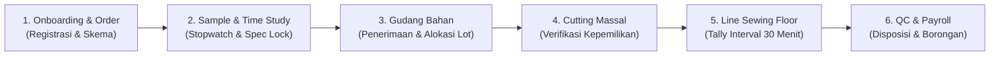

# Panduan Pengguna Operasional Pabrik — Lukla Operations Engine

**Sistem Manajemen Produksi & Penggajian Konveksi Terpadu (Maklon & CMT)**  
*Fasilitas Manufaktur Ciwidey — Lukla Manufacturing × Snøhund*

> **User Guide Book — MAIN 2026**
> Dokumen ini menjelaskan prototype kerja **Sampling & Spec R&D** pada `prototypes/sampling-spec-rnd/`. Prototype berjalan sebagai frontend React/Vite dan backend FastAPI, dengan backend Operations Engine utama sebagai layanan pendukung untuk endpoint `/api/v1`.

## Persyaratan Sistem

| Komponen | Persyaratan |
|---|---|
| Sistem operasi | Windows 10/11, Linux, atau macOS |
| Python | Python 3.11 direkomendasikan; dependency backend didefinisikan di `prototypes/sampling-spec-rnd/backend/requirements.txt` |
| Node.js | Node.js 20 atau lebih baru |
| Browser | Google Chrome, Microsoft Edge, atau browser Chromium modern; Chrome diperlukan untuk mencetak dokumen PDF dengan langkah pada panduan ini |
| Git | Git untuk mengambil source code dari repository |
| Perangkat | RAM minimal 4 GB dan ruang disk minimal 2 GB untuk dependency lokal |

## Instalasi

Jalankan perintah berikut dari direktori root repository. Pada Windows gunakan PowerShell.

### 1. Ambil source code

```powershell
git clone <URL-REPOSITORY>
cd hackathon-MAIN-alkademi
```

Kalau berhasil, perintah `git status` menampilkan direktori repository dan tidak melaporkan folder yang tidak ditemukan.

### 2. Pasang dependency backend Sampling & Spec R&D

```powershell
cd prototypes\sampling-spec-rnd\backend
py -3.11 -m venv .venv
.\.venv\Scripts\python.exe -m pip install -r requirements.txt
cd ..\..\..
```

Linux/macOS:

```bash
cd prototypes/sampling-spec-rnd/backend
python3.11 -m venv .venv
.venv/bin/python -m pip install -r requirements.txt
cd ../../..
```

Langkah ini berhasil kalau `\.venv\Scripts\python.exe -m pip check` pada Windows, atau `.venv/bin/python -m pip check` pada Linux/macOS, menampilkan `No broken requirements found.`

### 3. Pasang dependency frontend

```powershell
cd prototypes\sampling-spec-rnd\frontend
npm install
cd ..\..\..
```

Instalasi selesai kalau `npm` tidak menampilkan error dan folder `prototypes/sampling-spec-rnd/frontend/node_modules` tersedia.

## Menjalankan Aplikasi

Prototype memakai tiga terminal. Backend utama port `8000` diperlukan oleh proxy `/api/v1`; backend Sampling port `8009` melayani endpoint prototype dan Copilot; frontend Vite berjalan di port `3009`.

### Terminal 1 — Backend Operations Engine utama (port 8000)

```powershell
cd backend
python -m uvicorn app.main:app --reload --port 8000
```

Buka `http://localhost:8000/docs`. Kalau halaman Swagger API tampil, layanan utama sudah aktif.

### Terminal 2 — Backend Sampling & Spec R&D (port 8009)

```powershell
cd prototypes\sampling-spec-rnd\backend
.\.venv\Scripts\Activate.ps1
uvicorn src.main:app --reload --port 8009
```

Buka `http://localhost:8009/health`. Respons yang benar memuat `"status":"healthy"` dan `"service":"sampling-spec-rnd-api"`. Dokumentasi API tersedia di `http://localhost:8009/docs`.

### Terminal 3 — Frontend (port 3009)

```powershell
cd prototypes\sampling-spec-rnd\frontend
npm run dev
```

Pastikan terminal Vite menampilkan alamat `http://localhost:3009/`, lalu buka alamat itu di browser.

### Login dan akses awal

1. Buka `http://localhost:3009/`.
2. Pada field login **identifier**, masukkan `ADMIN-IT`.
3. Masukkan password `Admin#12345`.
4. Tekan tombol masuk dan pastikan dashboard tampil.

Credential demo:

| Field | Nilai |
|---|---|
| Identifier | `ADMIN-IT` |
| Password | `Admin#12345` |

Backend utama port `8000` harus tetap aktif. Kalau tidak, halaman prototype dan modul yang memanggil `/api/v1` bisa menampilkan error jaringan meski backend `8009` dan frontend sudah berjalan.

---

## 1. Konteks Bisnis & Model Kerja Pabrik

Di Ciwidey, Lukla Manufacturing menjalankan satu pabrik konveksi garmen terpadu. Kapasitas mesinnya dinamis, sampai sekitar **±70 mesin jahit aktif**. Dari satu atap itu, pabrik mengerjakan pakaian untuk brand internal **Snøhund** dan, pada saat yang sama, melayani berbagai **klien maklon B2B eksternal**.

### Tiga Skema Kerjasama Maklon

Setiap Surat Perintah Kerja (Order) memakai salah satu dari tiga skema. Skema ini menentukan siapa pemilik bahan dan siapa yang menyediakan bahan baku:

```
┌─────────────────────────────────────────────────────────────────────────────┐
│                       SKEMA KERJASAMA OPERASIONAL PABRIK                   │
├─────────────────────┬───────────────────────────────────────────────────────┤
│ Skema               │ Tanggung Jawab Pengadaan                              │
├─────────────────────┼───────────────────────────────────────────────────────┤
│ 1. CMT              │ Klien menyediakan 100% bahan baku (kain utama).       │
│    (Cut, Make, Trim)│ Lukla menyediakan jasa potong, jahit, dan finishing.  │
├─────────────────────┼───────────────────────────────────────────────────────┤
│ 2. Semi-CMT         │ Klien menyediakan kain utama.                         │
│                     │ Lukla menyediakan bahan pembantu, benang, & aksesoris.│
├─────────────────────┼───────────────────────────────────────────────────────┤
│ 3. CMT + Bahan      │ Lukla menyediakan seluruh bahan dan jasa produksi.    │
│    (Full Package)   │ Dipakai untuk order brand Snøhund & klien full-order. │
└─────────────────────┴───────────────────────────────────────────────────────┘
```

> **PENTING:**
> **Prinsip Anti-Kontaminasi Silang (FR-6.2):**  
> Bahan baku titipan milik Klien A (misal: Snøhund) berstatus barang titipan (*custodial material*) dan **dilarang keras** dipakai untuk pesanan Klien B (misal: Brand-X). Sistem otomatis mengunci dan menolak pengeluaran bahan kalau ID Klien dan ID Order tidak cocok.

### Alur Operasional 6 Fase End-to-End



---

## 2. Akses Sistem & Navigasi Antarmuka

Akses Lukla Operations Engine melalui peramban web seperti Google Chrome, Safari, atau Microsoft Edge pada alamat server lokal atau domain pabrik.

### Titik Akses Portal Sentral (`/`)

Buka `http://localhost:3009/` di lingkungan lokal. Dari tampilan prototype, buka modul operasional dan pendukung berikut:

1. **Lukla Operations Dashboard (`/ui`):** Antarmuka utama operasional pabrik yang memuat 6 layar kerja harian.
2. **Lukla Intelligence AI Copilot (`/copilot`):** Asisten AI interaktif untuk pengecekan data stok kain, efisiensi line, dan status order.
3. **Sampling & Spec R&D Portal (`/sampling/`):** Portal khusus teknisi sample untuk pencatatan time study n≥30 dan versioning spesifikasi.
4. **Interactive API Docs (`/docs`):** Dokumentasi teknis OpenAPI 3.1 Swagger untuk integrasi sistem.

### Navigasi Sidebar Dashboard ERP

Di halaman `/ui`, buka menu navigasi pada bilah sisi kiri (*sidebar*):

| Tombol Navigasi | Kode Layar | Modul Operasional | Pengguna Utama |
|---|---|---|---|
| `01 Operations Dashboard` | `view-01` | Ringkasan Eksekutif & Line Speed | Owner, Kepala Operasional |
| `02 Sample & Time Study` | `view-02` | Tracker Spesifikasi & Stopwatch | Tim Sample Adis |
| `03 Warehouse Inventory` | `view-03` | Stok Multi-Klien & Dispatch Bahan | Gudang / Warehouse |
| `04 Floor Terminal` | `view-04` | Input Tally Interval 30 Menit | Mandor Line Produksi |
| `05 QC Inspection` | `view-05` | Pemeriksaan Mutu per Garmen | QC Inspector |
| `06 Payroll & Costing` | `view-06` | Kalkulasi Borongan & QC Bonus | Finance & Payroll |

---

## 3. Playbook Operasional 8 Peran Pengguna (RBAC)

Sistem membatasi akses berdasarkan matriks **Role-Based Access Control (RBAC)** agar wewenang tetap tepat dan data tidak mudah dimanipulasi.

```
┌────────────────────────────────────────────────────────────────────────────────────────┐
│                          MATRIKS RBAC 8 PERAN OPERASIONAL PABRIK                       │
├────┬───────────────────────┬───────────────────────────────┬───────────────────────────┤
│ No │ Peran Sistem          │ Hak Akses (IZIN)              │ Pembatasan (PEMBATASAN)   │
├────┼───────────────────────┼───────────────────────────────┼───────────────────────────┤
│ 1  │ Owner / Eksekutif     │ Analisis tinggi, ubah rate    │ Tidak dapat mengubah      │
│    │                       │ card, konfigurasi sistem      │ transaksi ledger terkunci │
├────┼───────────────────────┼───────────────────────────────┼───────────────────────────┤
│ 2  │ Tim Sample / Adis     │ Catat pemakaian sample, input │ Dilarang setujui order    │
│    │                       │ time study, setujui versi     │ massal tanpa konfirmasi   │
├────┼───────────────────────┼───────────────────────────────┼───────────────────────────┤
│ 3  │ Gudang / Warehouse    │ Terima bahan/titipan, stok    │ Dilarang keluarkan bahan  │
│    │                       │ opname, dispatch ke cutting   │ jika ID Klien beda (FR6.2)│
├────┼───────────────────────┼───────────────────────────────┼───────────────────────────┤
│ 4  │ Kepala Produksi/Mandor│ Alokasi penjahit, rate card   │ Tidak dapat ubah formula  │
│    │                       │ komponen, tally 30 menit      │ payroll atau hasil final QC│
├────┼───────────────────────┼───────────────────────────────┼───────────────────────────┤
│ 5  │ Penjahit / Tailor     │ Lihat tugas komponen, lapor   │ Tidak dapat edit output   │
│    │                       │ hasil kerja ke mandor         │ yang telah diverifikasi   │
├────┼───────────────────────┼───────────────────────────────┼───────────────────────────┤
│ 6  │ QC Inspector          │ Periksa fisik garmen, set     │ Tidak dapat ubah harga    │
│    │                       │ Pass/Repair/Scrap, catat cacat│ borongan atau data order  │
├────┼───────────────────────┼───────────────────────────────┼───────────────────────────┤
│ 7  │ Finance & Payroll     │ Buat PO bahan, invoice, hitung│ Tidak dapat mengubah fisik│
│    │                       │ gaji mingguan & bulanan       │ stok di gudang            │
├────┼───────────────────────┼───────────────────────────────┼───────────────────────────┤
│ 8  │ Klien Maklon B2B      │ Pantau progres order real-time│ Terbatas ketat hanya pada │
│    │ (Portal Eksternal)    │ dan stok kain milik sendiri   │ data `client_id` sendiri  │
└────┴───────────────────────┴───────────────────────────────┴───────────────────────────┘
```

---

### Peran 1: Owner / Eksekutif

**Tanggung Jawab:** Memantau kesehatan operasional seluruh pabrik, memvalidasi rate card biaya garmen, dan mengawasi profitabilitas maklon.

#### SOP Harian Owner
1. **Pemeriksaan Pagi (08:30 WIB):**
   - Buka menu `01 Operations Dashboard`.
   - Periksa widget **Line Status** (contoh: target 62 dari 70 mesin aktif). Jika di bawah 80%, koordinasikan dengan Kepala Produksi.
   - Periksa **Run-Rate Pabrik** (target hijau ≥90%).
2. **Evaluasi Kecepatan Line (Siang & Sore):**
   - Pantau grafik **30-Min Interval Factory Speed Output Graph**.
   - Identifikasi apakah terjadi *bottleneck* (penurunan drastis output) pada interval jam tertentu (misal jam 11:30–12:00 menjelang istirahat).
3. **Pengelolaan Rate Card Borongan:**
   - Masuk ke menu `06 Payroll & Costing Workspace`.
   - Evaluasi usulan rate card komponen baru dari Mandor. Owner memiliki wewenang menyetujui perubahan tarif per komponen garmen.
   - Owner tidak dapat menghapus atau mengubah angka jurnal pembukuan yang telah diposting ke ledger keuangan.

---

### Peran 2: Tim Sample / Adis

**Tanggung Jawab:** Menguji pembuatan prototipe pakaian, mencatat standar waktu siklus jahit (*time study*), dan mengunci spesifikasi sebelum produksi massal.

#### SOP Pengujian Sampel & Time Study
1. **Penerimaan Pola & Permintaan Sampel:**
   - Buka menu `02 Sample & Time Study Tracker`.
   - Pilih spesifikasi produk yang sedang diuji (contoh: `Spec: Arctic Parka`).
2. **Pengambilan Waktu Jahit (Stopwatch Observation):**
   - Siapkan operator sampel untuk menjahit komponen uji (contoh: `Collar Stitch`).
   - Gunakan stopwatch digital pada antarmuka. Tekan tombol saat penjahitan dimulai.
   - Setelah jahitan komponen selesai, waktu tercatat (contoh: `00:04:12.4` atau 252.4 detik).
   - Klik tombol **"Save to Time Study"**.
3. **Penyusunan Standar Waktu & Tarif:**
   - Periksa **Time Study Table**: bandingkan waktu target (*target seconds*) dengan waktu observasi terakhir (*last observed*).
   - Tentukan tarif borongan operator per potong (contoh: `Collar Stitch Rp 1.450/pc`, `Sleeve Assembly Rp 1.780/pc`).
4. **Penguncian Versi Spesifikasi:**
   - Jika sampel telah disetujui klien, kunci spesifikasi menjadi versi aktif (contoh: `Active Version: v2 (Locked)`).
   - Tim Sample dilarang mengubah status order menjadi produksi massal tanpa Surat Persetujuan tertulis dari Klien.

---

### Peran 3: Gudang / Warehouse

**Tanggung Jawab:** Menerima kiriman kain, menyimpan bahan berdasarkan lot kepemilikan klien, dan mengeluarkan kain ke bagian pemotongan (*cutting*).

#### SOP Penerimaan Bahan & Dispatch
1. **Penerimaan & Registrasi Lot Bahan:**
   - Periksa surat jalan fisik dari supplier atau klien maklon.
   - Pastikan label lot terpasang pada rol kain (contoh: `LOT-2026-99`, jenis `Poly-Oxford 600D`, panjang 420 meter).
   - Catat pemilik legal kain (`Snøhund` atau `Brand-X`).
2. **Penyimpanan di Rak Gudang:**
   - Simpan kain di lokasi rak terdaftar (contoh: `Rak A-04`).
3. **Pengeluaran Bahan ke Bagian Cutting (Dispatch):**
   - Buka menu `03 Warehouse Inventory`.
   - Gunakan kotak **Filter by Client** atau cari kode lot di kolom **Search Lot Tag**.
   - Temukan baris lot kain yang dialokasikan untuk Surat Perintah Kerja tertentu (contoh: Order `ORD-401`).
   - Klik tombol **"Dispatch"**.
4. **Penanganan Guardrail Error FR-6.2 (Ownership Mismatch):**
   - Kalau pop-up merah berikut muncul:
     `Dispatch Ditolak — Ownership Mismatch. Stock milik Client A tidak dapat diterbitkan ke Order Client B.`
   - Kalau begitu, batalkan pengeluaran! Periksa kembali Surat Perintah Kerja. Jangan pernah mencoba memotong kain milik klien lain untuk menutupi kekurangan bahan.

---

### Peran 4: Kepala Produksi / Mandor

**Tanggung Jawab:** Memimpin penjahit di line produksi, mengalokasikan tugas komponen jahitan, dan menginput hasil kerja per interval 30 menit.

#### SOP Input Tally Floor Terminal (Setiap 30 Menit)
1. **Persiapan Terminal:**
   - Mandor menggunakan tablet layar sentuh pada line masing-masing.
   - Buka menu `04 Floor Terminal`.
   - Pastikan bilah informasi atas sudah sesuai:
     - **Line:** `Line 03`
     - **Mandor:** `Budi`
     - **Interval:** `13:30 – 14:00`
2. **Pencatatan Hasil per Penjahit:**
   - Datangi setiap operator di grid penjahit, lalu hitung bundel jahitan yang sudah selesai:
     - `Tailor #14: Rudi S.` (Sleeve Assembly): Tekan tombol `+` atau `-` hingga angka menunjukkan output fisik (misal: `14` pcs).
     - `Tailor #18: Mira K.` (Collar Stitch): Atur angka (misal: `11` pcs).
     - `Tailor #22: Sari P.` (Hem Finish): Atur angka (misal: `16` pcs).
     - `Tailor #27: Dedi A.` (Front Panel): Atur angka (misal: `13` pcs).
3. **Penguncian & Pengiriman Tally:**
   - Setelah memeriksa semua penjahit, klik tombol biru besar: **"SUBMIT INTERVAL BLOCK"**.
   - Sistem menyimpan data dan mengunci interval tersebut.
   - Mandor dilarang mengubah hasil QC garmen atau rumus penggajian borongan.

---

### Peran 5: Penjahit / Tailor

**Tanggung Jawab:** Menjahit komponen pakaian sesuai spesifikasi teknis dan melaporkan output fisik kepada mandor pada setiap pergantian interval.

#### Pedoman Kerja Penjahit
1. **Memulai Shift:**
   - Terima instruksi komponen kerja dari Mandor (misal: hari ini bertugas mengerjakan `Sleeve Assembly` pada Order `ORD-401`).
   - Pastikan nomor penjahit dan nama tercatat di daftar line (misal: `Tailor #14: Rudi S.`).
2. **Pelaporan Fisik per 30 Menit:**
   - Tumpuk garmen yang selesai dijahit rapi di samping mesin dengan kartu bundel kerja.
   - Saat mandor berkeliling pada akhir interval (tiap menit ke-30), tunjukkan bundel fisik untuk dihitung bersama.
   - Setelah mandor menekan submit dan memverifikasi tally, penjahit tidak dapat meminta pengubahan angka secara sepihak tanpa persetujuan Kepala Operasional.

---

### Peran 6: QC Inspector

**Tanggung Jawab:** Memeriksa kualitas jahitan pakaian jadi satu per satu (*piece-by-piece inspection*), menetapkan kelayakan produk, dan mencatat cacat.

#### SOP Pemeriksaan Mutu Garmen Jadi
1. **Buka Terminal Inspeksi:**
   - Buka menu `05 QC Inspection Terminal`.
   - Periksa informasi pesanan aktif pada bilah konteks (contoh: `Order: ORD-401 (Snøhund)`).
   - Identifikasi nomor seri barcode pada garmen (contoh: `Garment Unit Serial: SN-401-0891`).
2. **Pemeriksaan Fisik Garmen:**
   - Periksa jahitan kerah, kancing, simetri lengan, kerapian kelim, dan kebersihan bahan satu per satu.
3. **Pemilihan Disposisi (Keputusan Mutu):**
   - Pilih salah satu dari tiga tombol utama:
     - 🟢 **`(A) PASS` (Tombol Hijau):** Garmen sempurna, lolos ke tahap packing dan masuk ke dalam kalkulasi bonus QC.
     - 🟡 **`(B) REPAIR` (Tombol Kuning):** Ada cacat minor yang bisa diperbaiki penjahit tanpa merusak bahan.
     - 🔴 **`(C) SCRAP / REJECT` (Tombol Merah):** Bahan rusak fatal/cacat potong yang tidak bisa diperbaiki.
4. **Pencatatan Taksonomi Cacat (Jika Repair/Reject):**
   - Di panel **Defect taxonomy**, centang setiap jenis kerusakan yang ditemukan:
     - `[x] Broken Stitch` (Jahitan putus/loncat)
     - `[x] Puckering` (Kain mengkerut di garis jahitan)
     - `[x] Uneven Seam` (Sambungan jahitan melenceng/tidak rata)
   - QC Inspector tidak memiliki wewenang mengubah harga borongan penjahit atau mengubah data pesanan klien.

---

### Peran 7: Finance & Payroll

**Tanggung Jawab:** Menghitung upah borongan mingguan penjahit, memproses uang makan, mendistribusikan bonus pool QC, dan mencatat jurnal keuangan ke buku besar.

#### SOP Penggajian Mingguan (Setiap Sabtu Sore)
1. **Buka Workspace Penggajian:**
   - Buka menu `06 Payroll & Costing Workspace`.
   - Periksa siklus periode penggajian (contoh: `Cycle: Week 41 (Ending Saturday)` | `Tailors Processed: 68`).
2. **Verifikasi Komponen Biaya:**
   - **Base Borongan:** Total upah murni dari akumulasi unit lolos jahit (contoh: `Rp 42.150.000`).
   - **Uang Makan (12.5%):** Tunjangan makan mingguan otomatis (contoh: `Rp 5.268.750`).
   - **Passed QC Units:** Jumlah fisik pakaian yang dinyatakan lolos inspeksi QC (contoh: `2.800 pcs`).
   - **QC Bonus Pool:** Bonus pencapaian target mutu pakaian lolos.  
     *Aturan Pembagian 3-Arah:* Total bonus (contoh: `Rp 2.800.000`) dibagi rata ke 3 penanggung jawab:
     - Mandor 1: `Rp 933.333`
     - Mandor 2: `Rp 933.333`
     - Kepala Operasional: `Rp 933.334`
   - **Overhead Pabrik:** Alokasi beban bulanan pabrik per unit pakaian (contoh: `Rp 4.120 /pcs`).
3. **Pemeriksaan Preview Jurnal Finansial (Double-Entry Ledger):**
   - Periksa tabel pratinjau jurnal akuntansi berikut:
     - `Direct Labour Expense` (Debit: Rp 42.150.000) ↔ `Payroll Payable` (Kredit: Rp 42.150.000)
     - `QC Bonus Expense` (Debit: Rp 2.800.000) ↔ `QC Bonus Payable` (Kredit: Rp 2.800.000)
   - Pastikan posisi debit dan kredit **seimbang mutlak (Zero-Sum Balance)** sebelum melanjutkan.
4. **Eksekusi Penggajian:**
   - Klik tombol biru besar: **"EXECUTE PAYROLL RUN (SAT)"**.
   - Sistem mencatat transaksi ke ledger *append-only*. Isinya hanya bisa ditambah, tidak bisa diubah.
   - Finance tidak boleh mengubah angka fisik stok kain di gudang secara manual.

---

### Peran 8: Klien Maklon B2B

**Tanggung Jawab:** Mitra pemesan yang memantau progres produksi dan stok bahan titipannya secara terbuka.

#### Panduan Portal Klien
1. **Login Portal Eksternal:** Masuk dengan kredensial khusus yang diberikan oleh tim Lukla.
2. **Monitoring Progres Order:**
   - Pantau persentase penyelesaian tiap pesanan:
     - Contoh: `Order ORD-401 (Snøhund)` berstatus `68%` selesai.
     - Contoh: `Order ORD-402 (Brand-X)` berstatus `42%` selesai.
3. **Transparansi Stok Bahan Titipan:**
   - Pantau sisa meter kain milik sendiri yang tersimpan di gudang Lukla.
   - Berkat arsitektur *Multi-Tenant Row-Level Security*, Klien A tidak akan pernah bisa melihat nama klien lain, jenis bahan klien lain, maupun detail biaya internal pabrik.

---

## 4. Panduan Operasional 6 Layar Utama ERP

### Layar 01: Executive Operations Dashboard

```
┌─────────────────────────────────────────────────────────────────────────────┐
│ 01 — Executive Operations Dashboard                          /app/overview  │
├─────────────────────┬───────────────────────────────┬───────────────────────┤
│ Line Status         │ Active Clients                │ Run-Rate Pabrik       │
│ 62/70 Active        │ Snøhund, Brand-X              │ 94%                   │
├─────────────────────┴───────────────────────────────┴───────────────────────┤
│ [Grafik Kecepatan Pabrik per 30 Menit (Line 03: 08:00 - 14:00)]             │
│ [Grid Komitmen Order: ORD-401 (68%), ORD-402 (42%), ORD-399 (91%)]          │
└─────────────────────────────────────────────────────────────────────────────┘
```

- Pantau kapasitas mesin, output garmen setiap interval kerja, dan progres pesanan klien dari satu layar.
- Perhatikan bagian-bagian ini:
  - Status Strip 3 Kotak di bagian atas menampilkan status instan fasilitas.
  - Grafik batang dan garis memperlihatkan lonjakan atau penurunan produktivitas per jam.
  - Tabel progres pesanan dilengkapi batang persentase visual berwarna biru.

---

### Layar 02: Sample & Time Study Tracker

```
┌─────────────────────────────────────────────────────────────────────────────┐
│ 02 — Sample & Time Study Tracker                              /app/samples  │
├─────────────────────────────────────────────────────────────────────────────┤
│ Spec: Arctic Parka  |  Active Version: v2 (Locked)  |  History: v1 Archive   │
├─────────────────────────────────────────────────────────────────────────────┤
│ Current Time Study: Component: Collar Stitch                                │
│ STOPWATCH: 00:04:12.4  (Operator: Adis T.)     [Save to Time Study (Btn)]   │
├─────────────────────────────────────────────────────────────────────────────┤
│ Tabel Komponen: Target (detik) | Terakhir Diamati | Tarif Operator (Rp/pc)  │
│ - Collar Stitch: 248.0s        | 252.4s           | Rp 1.450                │
│ - Sleeve Assembly: 312.0s      | 306.8s           | Rp 1.780                │
│ - Hem Finish: 184.0s           | 190.1s           | Rp 1.120                │
└─────────────────────────────────────────────────────────────────────────────┘
```

- Ukur waktu kerja tiap komponen garmen sebelum menetapkan harga borongan.
- Bagian pentingnya:
  - Baris status spesifikasi menampilkan status versi aktif yang terkunci.
  - Modul stopwatch digital dengan pencatatan waktu menit, detik, dan milidetik.
  - Tabel pembanding waktu standar vs waktu aktual beserta tarif rupiah per komponen.

---

### Layar 03: Multi-Client Warehouse Inventory Grid

```
┌─────────────────────────────────────────────────────────────────────────────┐
│ 03 — Multi-Client Warehouse Inventory Grid                  /app/materials  │
├─────────────────────────────────────────────────────────────────────────────┤
│ Filter by Client: [ All v ]     Search Lot Tag: [ LOT-2026-99 ]             │
├─────────────────┬───────────┬──────────────┬─────────────┬──────────────────┤
│ Item Kain       │ Pemilik   │ Alokasi Order│ Saldo Stok  │ Aksi             │
├─────────────────┼───────────┼──────────────┼─────────────┼──────────────────┤
│ Poly-Oxford     │ Snøhund   │ ORD-401      │ 420m        │ [Dispatch]       │
│ Thermolite      │ Brand-X   │ ORD-402      │ 184m        │ [Dispatch]       │
└─────────────────┴───────────┴──────────────┴─────────────┴──────────────────┤
│ ⚠️ MODAL PERINGATAN (Jika Mismatch):                                        │
│ "Dispatch Ditolak — Ownership Mismatch (FR-6.2)"                            │
└─────────────────────────────────────────────────────────────────────────────┘
```

- Cegah kain titipan klien tertukar atau salah dikirim ke ruang potong (*cutting*).
- Yang bisa dipakai:
  - Filter cepat berdasarkan nama Klien atau pencarian nomor Rol / Lot Kain.
  - Tombol **Dispatch** untuk mengeluarkan bahan dari gudang.
  - Modal pengaman otomatis jika operator memilih order yang tidak berhak atas kain tersebut.

---

### Layar 04: Floor Terminal (Tally 30 Menit)

```
┌─────────────────────────────────────────────────────────────────────────────┐
│ 04 — Floor Terminal (30-Minute Touch Interface)             /terminal/tally │
├─────────────────────────────────────────────────────────────────────────────┤
│ Line: Line 03   |   Mandor: Budi   |   Interval: 13:30 – 14:00              │
├──────────────────────────────────────┬──────────────────────────────────────┤
│ Tailor #14: Rudi S. (Sleeve Assembly)│ Tailor #18: Mira K. (Collar Stitch)  │
│ [ - ]    14 pcs    [ + ]             │ [ - ]    11 pcs    [ + ]             │
├──────────────────────────────────────┼──────────────────────────────────────┤
│ Tailor #22: Sari P. (Hem Finish)     │ Tailor #27: Dedi A. (Front Panel)    │
│ [ - ]    16 pcs    [ + ]             │ [ - ]    13 pcs    [ + ]             │
├──────────────────────────────────────┴──────────────────────────────────────┤
│                      [ SUBMIT INTERVAL BLOCK ]                              │
└─────────────────────────────────────────────────────────────────────────────┘
```

- Catat hasil kerja penjahit setiap 30 menit langsung dari lantai produksi.
- Yang perlu diketahui:
  - Tombol stepper ukuran besar (`+` dan `-`) yang ramah sentuhan jari operator.
  - Kotak angka besar bertipe monospaced tabular untuk mencegah salah baca.
  - Tombol submit interval selebar layar untuk konfirmasi akhir mandor.

---

### Layar 05: QC Inspection Terminal

```
┌─────────────────────────────────────────────────────────────────────────────┐
│ 05 — QC Inspection Terminal                                    /app/quality │
├─────────────────────────────────────────────────────────────────────────────┤
│ Order: ORD-401 (Snøhund)   |   Garment Unit Serial: SN-401-0891             │
├─────────────────────────────────────────────────────────────────────────────┤
│ KEPUTUSAN MUTU (DISPOSISI):                                                 │
│ [ (A) PASS (Hijau) ]   [ (B) REPAIR (Kuning) ]   [ (C) SCRAP/REJECT (Merah) ]│
├─────────────────────────────────────────────────────────────────────────────┤
│ TAKSONOMI CACAT (DEFECTS):                                                  │
│ [ ] Broken Stitch        [ ] Puckering             [ ] Uneven Seam          │
└─────────────────────────────────────────────────────────────────────────────┘
```

- Tetapkan kelulusan tiap garmen dan catat cacatnya untuk evaluasi bagian sewing.
- Detail yang menonjol:
  - Tiga tombol aksi besar dengan pembedaan warna standar internasional.
  - Kotak centang taksonomi cacat standar garmen (jahitan putus, kerutan, atau sambungan miring).

---

### Layar 06: Payroll & Costing Workspace

```
┌─────────────────────────────────────────────────────────────────────────────┐
│ 06 — Payroll & Costing Workspace                               /app/finance │
├─────────────────────────────────────────────────────────────────────────────┤
│ Cycle: Week 41 (Ending Saturday)   |   Tailors Processed: 68 Penjahit       │
├─────────────────────────────────────────────────────────────────────────────┤
│ RINGKASAN BIAYA PENGGAJIAN:                                                 │
│ - Base Borongan                                    : Rp 42.150.000          │
│ - Uang Makan (12.5%)                               : Rp  5.268.750          │
│ - Passed QC Units                                  : 2.800 pcs              │
│ - QC Bonus Pool (Bagi 3: Mandor 1, Mandor 2, Koord): Rp  2.800.000          │
│ - Overhead Pabrik per Unit                         : Rp  4.120 /pcs         │
├─────────────────────────────────────────────────────────────────────────────┤
│ PRATINJAU DOUBLE-ENTRY LEDGER:                                              │
│ Debit: Direct Labour Expense (Rp 42.150.000) ↔ Kredit: Payroll Payable      │
│ Debit: QC Bonus Expense      (Rp  2.800.000) ↔ Kredit: QC Bonus Payable     │
├─────────────────────────────────────────────────────────────────────────────┤
│                   [ EXECUTE PAYROLL RUN (SAT) ]                             │
└─────────────────────────────────────────────────────────────────────────────┘
```

- Verifikasi hak upah pekerja dan catatan akuntansi sebelum pembayaran diproses.
- Yang perlu dicek:
  - Rincian matematis borongan, uang makan, dan pembagian bonus mutu.
  - Pratinjau mutasi debit-kredit buku besar yang memastikan kepatuhan akuntansi.
  - Tombol eksekusi penggajian mingguan.

---

## 5. Panduan Lukla Intelligence (AI Copilot)

**Lukla Intelligence** adalah asisten AI operasional pabrik yang terhubung langsung ke database stok kain, status pesanan, dan rekap produksi.

### Cara Membuka AI Copilot
1. **Widget Melayang:** Klik tombol bundar hitam berikon bintang di sudut kanan bawah antarmuka pada layar mana pun. Drawer obrolan akan terbuka dari sisi kanan.
2. **Laman Penuh:** Buka tautan aplikasi `http://localhost:3009/`, lalu pilih menu Copilot dari antarmuka.

### Fitur Utama Copilot
- **Pemilihan Peran Konteks:** Pilih peran (Owner, Gudang, Mandor, dsb.) dari menu dropdown di bilah atas obrolan supaya Copilot menjawab sesuai kewenangan tersebut.
- **Suggestion Chips:** Pilih saran cepat di bawah bilah atas (contoh: `"Cek stok bahan Poly-Oxford"`, `"Tampilkan status order"`, `"Cek performa Line 03"`).
- **Action Shortcut Cards:** Saat jawaban Copilot menyarankan tindakan, kartu navigasi menuju layar terkait akan muncul.

### Contoh Pertanyaan Operasional yang Didukung

```
Pengguna : "Berapa sisa kain Poly-Oxford yang siap dipakai untuk order Snøhund?"
Copilot  : "Stok Kain Poly-Oxford 600D untuk Snøhund (Order ORD-401) saat ini tersedia
            420 meter di Rak A-04 dengan kode LOT-2026-99. Status: Terisi dan Siap Cutting."

Pengguna : "Bagaimana status penyelesaian pesanan Brand-X saat ini?"
Copilot  : "Order ORD-402 (Brand-X) di bawah skema Semi-CMT saat ini berada di progres 42%.
            Bahan Thermolite tersedia 184 meter di Rak B-12."

Pengguna : "Apakah ada peringatan kontaminasi bahan hari ini?"
Copilot  : "Nol insiden kontaminasi silang. Seluruh permohonan dispatch bahan telah sesuai
            dengan kepemilikan client_id masing-masing."
```

---

## 6. Protokol Guardrails & Troubleshooting

### Peringatan FR-6.2: Ownership Mismatch pada Gudang

> **PERINGATAN:**
> **Penyebab:** Tombol *Dispatch* ditekan untuk rol kain milik Klien A, padahal Surat Perintah Kerja yang dipilih milik Klien B.
> **Lakukan langkah berikut:**
> 1. Klik tombol **"Mengerti"** untuk menutup modal peringatan.  
> 2. Periksa kembali kondisi fisik kain dan nomor rol.
> 3. Jangan melanjutkan proses potong jika identitas pemilik kain tidak identik dengan pemesan.

### Koreksi Kesalahan Tally Jahit oleh Mandor

- **Sebelum Tombol Submit Ditekan:** Mandor bebas menekan tombol `+` atau `-` untuk membetulkan jumlah unit.
- **Setelah Tombol Submit Ditekan:** Blok interval terkunci demi mencegah manipulasi upah borongan. Jika terjadi kesalahan hitung fatal, Mandor harus melapor kepada Kepala Operasional untuk dibuatkan catatan penyesuaian resmi.

### Garmen Berstatus REPAIR vs SCRAP pada QC

- **Status REPAIR (Kuning):** Garmen dikembalikan ke penjahit yang bersangkutan bersama bundel kartu cacat untuk diperbaiki (misal: jahitan putus atau kerutan minor). Unit ini belum berhak menerima upah borongan sampai dinyatakan *PASS* pada inspeksi ulang.
- **Status SCRAP (Merah):** Garmen dinyatakan gagal total dan dicatat sebagai susut produksi (*waste/defect*). Unit ini tidak mendapatkan upah borongan.

### Prinsip Imutabilitas Finansial (Buku Besar)

Sistem Lukla mencatat transaksi dengan standar akuntansi **Double-Entry Append-Only Ledger**:
- Data mutasi yang sudah disetujui **tidak dapat diubah (UPDATE) atau dihapus (DELETE)** oleh siapa pun, termasuk Owner.
- Jika terjadi kesalahan administratif dalam pembayaran, Finance harus menerbitkan **Transaksi Pembalik Kompensasi (*Compensating Reversal*)** baru yang membalikkan posisi debit dan kredit, dengan alasan yang tercatat di audit trail.

---

*PT Lukla Textile Manufacturing — Ciwidey, Jawa Barat*  
*Dokumentasi Resmi Operasional Sistem ERP & Intelligence*
