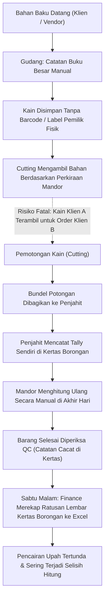
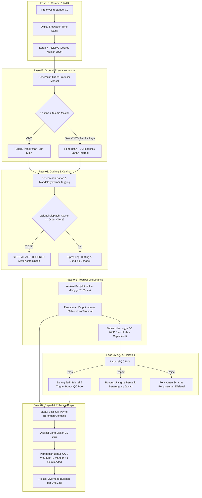
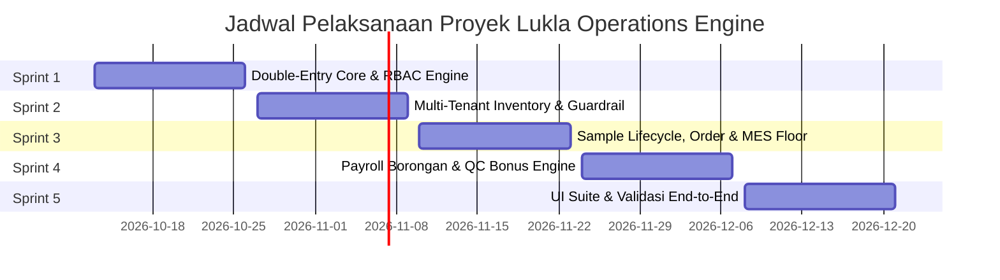

# BUSINESS REQUIREMENTS DOCUMENT (BRD)
## LUKLA OPERATIONS ENGINE

**Nama Proyek:** Lukla Operations Engine  
**Entitas Bisnis:** Lukla Manufacturing (Fasilitas Konveksi Ciwidey) × Snøhund  
**Lokasi Fasilitas:** Ciwidey, Kabupaten Bandung, Jawa Barat  
**Versi Dokumen:** 2.0.0  
**Tanggal Rilis:** 12 Oktober 2026  
**Status Dokumen:** Siap Review & Persetujuan (Baseline v2)  
**Klasifikasi:** Internal Confidential / Restricted Enterprise Blueprint  

---

### RIWAYAT REVISI DOKUMEN (VERSION HISTORY)

| Versi | Disetujui Oleh | Tanggal Revisi | Deskripsi Perubahan | Penulis / Analis |
| :--- | :--- | :--- | :--- | :--- |
| **0.1.0** | - | 12/10/2026 | Draft dekonstruksi awal dari slide presentasi pitch deck. | Engineering Team |
| **1.0.0** | Internal Lead | 12/10/2026 | Rilis v1 ringkasan dokumen gabungan BRD & PRD (79 baris). | Product Lead |
| **2.0.0** | Lead Solution Architect | 12/10/2026 | Rekonstruksi total mengikuti standar enterprise BRD 16-Bab (Smartsheet BRD Template). Integrasi penuh model akuntansi kustodial double-entry, pemisahan proses As-Is vs To-Be, tabel kebutuhan fungsional & non-fungsional terformalisasi, analisis dampak neraca, serta lampiran matematis & arsitektur. | Solution Architect / Consulting Director |

---

## DAFTAR ISI

1. [Ringkasan Eksekutif (Executive Summary Snapshot)](#1-ringkasan-eksekutif-executive-summary-snapshot)
2. [Deskripsi Proyek (Project Description)](#2-deskripsi-proyek-project-description)
3. [Ruang Lingkup Proyek (Project Scope)](#3-ruang-lingkup-proyek-project-scope)
4. [Pendorong Bisnis (Business Drivers)](#4-pendorong-bisnis-business-drivers)
5. [Proses Operasional Saat Ini (Current Process / As-Is)](#5-proses-operasional-saat-ini-current-process--as-is)
6. [Proses Operasional Usulan (Proposed Process / To-Be)](#6-proses-operasional-usulan-proposed-process--to-be)
7. [Kebutuhan Fungsional (Functional Requirements)](#7-kebutuhan-fungsional-functional-requirements)
8. [Kebutuhan Non-Fungsional (Non-Functional Requirements)](#8-kebutuhan-non-fungsional-non-functional-requirements)
9. [Dampak Laporan Keuangan & Neraca (Financial Statements Impact)](#9-dampak-laporan-keuangan--neraca-financial-statements-impact)
10. [Analisis Biaya & Manfaat (Cost and Benefit Analysis)](#10-analisis-biaya--manfaat-cost-and-benefit-analysis)
11. [Kebutuhan Sumber Daya (Resources Requirement)](#11-kebutuhan-sumber-daya-resources-requirement)
12. [Jadwal, Tonggak Pencapaian & Tenggat Waktu (Schedule, Milestones & Deadlines)](#12-jadwal-tonggak-pencapaian--tenggat-waktu-schedule-milestones--deadlines)
13. [Asumsi & Batasan Bisnis (Assumptions & Constraints)](#13-asumsi--batasan-bisnis-assumptions--constraints)
14. [Glosarium Terminologi (Glossary)](#14-glosarium-terminologi-glossary)
15. [Referensi Dokumen (References)](#15-referensi-dokumen-references)
16. [Lampiran Teknis & Spesifikasi Sistem (Appendix)](#16-lampiran-teknis--spesifikasi-sistem-appendix)

---

## 1. RINGKASAN EKSEKUTIF (EXECUTIVE SUMMARY SNAPSHOT)

Lukla Manufacturing mengoperasikan fasilitas manufaktur konveksi pakaian di Ciwidey, Jawa Barat, dengan skala kapasitas dinamis hingga kurang lebih 70 mesin jahit aktif. Fasilitas ini menjalankan model bisnis hibrida (*hybrid manufacturing model*): memenuhi kapasitas produksi untuk merek pakaian *in-house* **Snøhund**, sekaligus melayani jasa maklon (*contract toll-manufacturing*) untuk berbagai merek *fashion* eksternal (B2B). 

Saat ini, lantai produksi dan pergudangan Lukla menghadapi tiga titik kegagalan kritis (*critical failure points*):
1. **Pencampuran Fisik & Kontaminasi Silang Inventaris Multi-Tenant:** Bahan baku milik Klien A berisiko terpakai untuk pesanan Klien B, menyebabkan defisit stok, perselisihan hukum, dan kerugian finansial yang tidak dapat dipulihkan.
2. **Kekacauan Payroll Upah Borongan di Bawah Fluktuasi Tenaga Kerja (1–70+ Operator):** Pabrik tidak memiliki sistem upah tetap bulanan melainkan berbasis borongan (*piece-rate*). Rekonsiliasi manual setiap hari Sabtu memakan waktu lebih dari 8 jam, rawan kecurangan input, perhitungan uang makan (10–15%) yang fluktuatif, pembagian bonus QC 3 arah yang lambat, serta ketidakmampuan membebankan biaya *overhead* bulanan pabrik secara adil ke per unit pakaian.
3. **Hilangnya Jejak Revisi Prototipe (*R&D Spec Drift*):** Tidak adanya digitalisasi pencatatan sampel menyebabkan hasil *time study*, spesifikasi kain, dan *rate card* komponen tercecer di catatan kertas, memicu diskrepansi biaya dan target jahit saat pesanan dialihkan ke produksi massal.

**Lukla Operations Engine** adalah platform manajemen operasional manufaktur berbasis *event-driven* yang mengintegrasikan seluruh rantai proses (Sampel $\to$ Order $\to$ Gudang $\to$ Cutting $\to$ Jahit $\to$ QC $\to$ Payroll) dengan fondasi **Double-Entry Ledger yang bersifat *immutable* (kekal)**. Sistem menjamin segregasi kepemilikan material secara terprogram, pencatatan hasil kerja terminal lantai per 30 menit, dan otomatisasi kalkulasi komersial serta penggajian tanpa ketergantungan pada *spreadsheet* manual.

---

## 2. DESKRIPSI PROYEK (PROJECT DESCRIPTION)

Proyek ini bertujuan mengembangkan sistem inti (*core operating engine*) yang dirancang khusus untuk karakteristik unik industri konveksi garmen skala menengah di Indonesia. Model bisnis Lukla membagi kerja sama maklon menjadi tiga skema komersial utama yang mendikte kepemilikan fisik dan hukum atas bahan baku:

* **Skema CMT (Cut, Make, Trim):** Klien B2B menyediakan 100% bahan baku utama (kain) dan bahan pembantu/aksesoris. Lukla hanya menyediakan tenaga kerja dan mesin untuk jasa pemotongan (*cutting*), perakitan jahit (*sewing assembly*), dan penyelesaian akhir (*finishing*). Bahan klien berstatus **titipan kustodial** dan bukan merupakan aset neraca Lukla.
* **Skema Semi-CMT:** Klien B2B menyediakan bahan baku utama (kain luar/shell), sedangkan Lukla bertanggung jawab atas pengadaan bahan pembantu, furing, benang, kancing, serta resleting.
* **Skema CMT + Bahan (Full Package):** Lukla bertanggung jawab penuh atas pengadaan seluruh bahan baku, kain, aksesoris, serta menjalankan proses produksi ujung-ke-ujung. Skema ini juga merupakan model operasional baku untuk merek internal **Snøhund**.

Platform ini menggantikan sistem pencatatan kertas dan *spreadsheet* konvensional dengan arsitektur perangkat lunak terintegrasi yang memberlakukan aturan integritas data setingkat perbankan pada pergerakan barang dan pengakuan biaya tenaga kerja di lantai pabrik.

---

## 3. RUANG LINGKUP PROYEK (PROJECT SCOPE)

### 3.1 Dalam Ruang Lingkup (In Scope)
* **Manajemen Multi-Tenant & Identitas Kepemilikan Material:** Penandaan (*tagging*) wajib pasangan `client_id` dan `order_id` pada setiap lot bahan baku, rol kain, bundel potongan, dan barang jadi.
* **Validasi Anti-Kontaminasi Silang (Anti-Cross Contamination Guardrail):** Pembatasan sistemik setingkat basis data (*database-level trigger*) yang secara mutlak menolak penerbitan material milik Klien X untuk pesanan Klien Y.
* **Manajemen Siklus Sampel & R&D Time Study:** Pelacakan versi prototipe (v1, v2, dst.), instrumen *stopwatch* digital pencatat waktu perakitan per komponen garmen, penetapan konsumsi bahan, dan konversi spesifikasi master ke pesanan massal.
* **Pelacakan Output Lantai per 30 Menit (Shop Floor MES):** Terminal antarmuka ramah-sentuh (*touch-friendly terminal*) bagi mandor untuk menginput jumlah hasil jahit per penjahit/komponen dalam interval 30 menit.
* **Manajemen Alokasi Kapasitas Dinamis:** Penataan lini jahit fleksibel yang mampu menampung lonjakan operator dari skala kecil hingga 70+ penjahit tanpa batasan slot kaku.
* **Inspeksi Kontrol Kualitas (QC) & Taksonomi Cacat:** Klasifikasi unit menjadi *Pass*, *Repair*, atau *Reject/Scrap* beserta pencatatan jenis cacat garmen (*broken stitch, puckering, uneven seam*).
* **Mesin Penggajian Borongan Mingguan (Saturday Payroll Engine):**
  - Kalkulasi otomatis upah borongan penjahit: $\sum (\text{Qty Terverifikasi} \times \text{Rate Komponen})$.
  - Perhitungan uang makan mengambang (*floating meal allowance pool*) berbasis parameter input $10\% \text{ s/d } 15\%$ dari total ongkos jahit.
  - Perhitungan *QC Bonus Pool* 3 arah (dibagi rata untuk Mandor 1, Mandor 2, dan Kepala Operasional) dari akumulasi unit lolos QC.
  - Alokasi biaya *overhead* operasional bulanan pabrik (listrik, air, internet, sewa) ke per unit pakaian jadi.
* **Portal Eksternal Klien B2B:** Akses mandiri bagi klien maklon untuk memantau status pesanan, pencapaian milestone, dan saldo stok bahan titipan secara terisolasi.
* **Matriks Tata Kelola & Kontrol Akses Berbasis Peran (RBAC):** Penegakan hak akses dan pembatasan operasional pada 8 peran pengguna.

### 3.2 Di Luar Ruang Lingkup (Out of Scope)
* **Kompensasi Ketenagakerjaan Statuter:** Perhitungan potongan BPJS Ketenagakerjaan/Kesehatan, pajak penghasilan (PPh 21), uang lembur formal, dan pesangon formal (lingkup terbatas murni pada upah borongan dan tunjangan makan operasional).
* **Akuntansi Finansial Lengkap (Full General Ledger / Tax Audit):** Pelaporan pajak korporasi, amortisasi aset tetap gedung/mesin, dan rekonsiliasi perbankan multi-rekening eksternal.
* **Logistik Pengiriman & Armada Kendaraan:** Pelacakan armada truk ekspedisi pihak ketiga atau integrasi API kurir logistik eksternal.
* **Pengadaan Bahan Baku Terotomatisasi (Automated Procurement / MRP):** Pengambilan keputusan pembelian kain secara otomatis dari supplier tekstil (hanya mencakup pencatatan purchase order internal).
* **Aplikasi Seluler Native (iOS / Android):** Sistem dibangun berbasis Web Responsive PWA untuk perangkat desktop dan tablet sentuh industri.

---

## 4. PENDORONG BISNIS (BUSINESS DRIVERS)

Inisiatif pengembangan Lukla Operations Engine didorong oleh empat faktor strategis:

| No | Pendorong Bisnis | Dampak Strategis & Finansial |
| :--- | :--- | :--- |
| **BD-1** | **Proteksi Aset Kustodial & Kepatuhan Kontrak Maklon** | Menghilangkan risiko tuntutan hukum dan ganti rugi material akibat kain titipan klien terpakai oleh pesanan pihak lain. Mengembalikan kepercayaan merek *fashion* besar untuk menaruh volume produksi maklon bernilai tinggi di Lukla. |
| **BD-2** | **Efisiensi Administratif & Akurasi Penggajian Mingguan** | Mengeliminasi proses rekapitulasi manual di akhir pekan yang memakan waktu 8–10 jam kerja tim keuangan. Menghilangkan sengketa perhitungan jumlah jahitan borongan dengan operator jahit. |
| **BD-3** | **Optimalisasi Throughput & Visibilitas Lantai Pabrik** | Mengubah tata kelola pabrik dari pemantauan pasif berbasis catatan harian menjadi pemantauan aktif berbasis interval 30 menit. Mengidentifikasi penumpukan *bottleneck* komponen dalam hitungan jam, bukan di akhir hari kerja. |
| **BD-4** | **Standarisasi Biaya Pokok Produksi (COGS Precision)** | Menyediakan kalkulasi biaya riil per unit pakaian jadi yang akurat (bahan baku riil + ongkos jahit terverifikasi + alokasi overhead bulanan riil), mencegah terjadinya *underpricing* pada penawaran kontrak maklon baru. |

---

## 5. PROSES OPERASIONAL SAAT INI (CURRENT PROCESS / AS-IS)

Saat ini, seluruh operasional di pabrik Ciwidey mengandalkan dokumen kertas fisik (*surat jalan, travel card bundel, kartu borongan*) dan *spreadsheet* terpisah:



### Titik Masalah Utama (Pain Points) Alur As-Is:
1. **Penerimaan Gudang:** Stok titipan klien bercampur dengan stok kain milik Snøhund di rak yang sama tanpa identitas sistemik yang memblokir pengeluaran salah.
2. **Lantai Produksi:** Penjahit menghitung sendiri hasil produksinya di kartu kertas. Sering terjadi penggelembungan angka (*over-reporting*) atau kehilangan lembaran kartu borongan.
3. **Audit QC:** Cacat kain baru diketahui di tahap akhir tanpa keterlacakan penjahit mana yang bertanggung jawab atas komponen cacat tersebut.
4. **Rekonsiliasi Payroll:** Setiap Sabtu sore, tim finance harus merekapitulasi data borongan untuk ~70 penjahit dengan rumus uang makan dan bonus mandor secara manual di Excel, yang rentan terhadap salah ketik formula (*human error*).

---

## 6. PROSES OPERASIONAL USULAN (PROPOSED PROCESS / TO-BE)

Proses operasional baru mentransformasi pabrik menjadi ekosistem manufaktur berbasis sistem data terintegrasi 6 fase:



---

## 7. KEBUTUHAN FUNGSIONAL (FUNCTIONAL REQUIREMENTS)

### 7.1 Skala Prioritas Kebutuhan (Smartsheet Priority Rating System)

Sesuai standar BRD template, seluruh kebutuhan dipetakan ke dalam 5 tingkatan prioritas:

| Nilai (Value) | Tingkat (Rating) | Deskripsi Operasional |
| :---: | :--- | :--- |
| **1** | **Critical** | Wajib ada pada peluncuran perdana. Kegagalan fungsi ini menyebabkan sistem tidak dapat beroperasi atau melanggar integritas finansial/kustodial. |
| **2** | **High** | Sangat penting untuk keberhasilan proyek, namun sistem masih dapat berjalan secara terbatas dalam skenario Minimum Viable Product (MVP). |
| **3** | **Medium** | Memberikan nilai tambah efisiensi operasional yang signifikan, dapat dirilis pada iterasi pembaruan berikutnya. |
| **4** | **Low** | Fitur pendukung kenyamanan operasional (*nice-to-have*), keberhasilan proyek tidak bergantung secara langsung pada fitur ini. |
| **5** | **Future** | Di luar cakupan rilis saat ini, dicatat sebagai rencana pengembangan jangka panjang / fase lanjutan. |

---

### 7.2 Matriks Kategori Kebutuhan Fungsional

#### Kategori RC1: Manajemen Multi-Tenant & Keamanan Akses (RBAC & Tenancy)

| ID | Deskripsi Kebutuhan Fungsional | Prioritas | Diusulkan Oleh (Raised By) |
| :--- | :--- | :---: | :--- |
| **FR-1.1** | Sistem harus mengisolasi seluruh data operasional dan inventaris secara multi-tenant sehingga data Klien B2B tidak dapat diakses oleh klien lain. | 1 (Critical) | Owner & Legal |
| **FR-2.1** | Sistem harus menegakkan kontrol akses berbasis peran (RBAC) pada 8 peran pengguna dengan pembatasan mutlak antara pencatatan operasional dan penyesuaian finansial. | 1 (Critical) | Executive Management |
| **FR-3.1** | Sistem harus mencatat seluruh riwayat revisi dan transaksi ke dalam *audit trail* yang bersifat *append-only* (riwayat transaksi yang terkunci dilarang diubah bahkan oleh Owner). | 1 (Critical) | Finance & Auditor |

---

#### Kategori RC2: Siklus Sampel, Time Study & R&D Garmen

| ID | Deskripsi Kebutuhan Fungsional | Prioritas | Diusulkan Oleh (Raised By) |
| :--- | :--- | :---: | :--- |
| **FR-4.1** | Sistem harus mengelola siklus versi sampel prototipe (v1 $\to$ v2 $\to$ Approved Master Spec) dengan menyimpan riwayat perubahan parameter jahitan dan spesifikasi kain. | 2 (High) | Tim Sample / Adis |
| **FR-4.2** | Sistem harus menyediakan instrumen pencatatan *time study* (stopwatch digital) per komponen garmen untuk menghitung waktu standar kerja (*standard minute value*). | 2 (High) | Kepala Produksi |
| **FR-4.3** | Sistem harus menghasilkan *Master Spec Sheet* terkunci saat sampel disetujui klien dan mewariskan struktur komponen ke pesanan massal. | 1 (Critical) | Tim Sample & Owner |

---

#### Kategori RC3: Manajemen Gudang, Bahan Kustodial & Cutting

| ID | Deskripsi Kebutuhan Fungsional | Prioritas | Diusulkan Oleh (Raised By) |
| :--- | :--- | :---: | :--- |
| **FR-5.1** | Sistem harus mewajibkan input identitas pemilik (`client_id`) dan alokasi pesanan (`order_id`) saat penerimaan bahan baku kain (baik kain titipan maupun kain aset). | 1 (Critical) | Warehouse Manager |
| **FR-5.2** | Sistem harus mendukung pencatatan penerimaan bahan titipan (*consignment stock intake*) tanpa membebankannya sebagai hutang dagang lancar perusahaan. | 1 (Critical) | Finance Officer |
| **FR-6.1** | Sistem harus mengelola pencatatan stok opname dan pelacakan saldo rol kain secara *real-time* per lot inventaris. | 2 (High) | Warehouse Manager |
| **FR-6.2** | **Anti-Cross Contamination Engine:** Sistem harus memblokir dan menggagalkan secara otomatis upaya penerbitan kain/bahan baku ke lantai *cutting* jika `client_id` pemilik bahan berbeda dengan `client_id` pemesan pesanan kerja. | 1 (Critical) | Executive & B2B Clients |
| **FR-6.3** | Sistem harus mencatat hasil pemotongan kain massal, rasio limbah kain (*cutting scrap*), dan efisiensi konsumsi bahan terhadap pola sampel. | 2 (High) | Kepala Produksi |

---

#### Kategori RC4: Eksekusi Lantai Produksi (Shop Floor MES)

| ID | Deskripsi Kebutuhan Fungsional | Prioritas | Diusulkan Oleh (Raised By) |
| :--- | :--- | :---: | :--- |
| **FR-7.1** | Sistem harus mendukung pengaturan tata letak lini produksi dinamis dan alokasi fleksibel operator penjahit (skalabilitas 1 hingga 70+ mesin) tanpa konfigurasi slot kaku. | 1 (Critical) | Kepala Produksi / Mandor |
| **FR-7.2** | Sistem harus mengelola *rate card* ongkos jahit per komponen artikel berdasarkan hasil *time study*, serta mendukung perbedaan tarif antar-klien untuk artikel yang sama. | 1 (Critical) | Owner & Kepala Produksi |
| **FR-7.3** | Sistem harus menyediakan antarmuka terminal sentuh (*touch floor terminal*) bagi mandor untuk menginput jumlah hasil jahit per penjahit/komponen dalam blok interval 30 menit. | 1 (Critical) | Mandor (Line Floor) |
| **FR-7.4** | Setiap unit komponen hasil jahit yang tercatat pada terminal interval 30 menit harus otomatis berstatus `Menunggu QC` (*Awaiting QC*) dan mengikat hak upah bersyarat bagi operator. | 1 (Critical) | Mandor & Finance |

---

#### Kategori RC5: Kontrol Kualitas (QC) & Penanganan Cacat

| ID | Deskripsi Kebutuhan Fungsional | Prioritas | Diusulkan Oleh (Raised By) |
| :--- | :--- | :---: | :--- |
| **FR-8.1** | Sistem harus menyediakan antarmuka terminal QC untuk mengklasifikasikan unit garmen selesai ke dalam status: `Pass` (Lolos), `Repair` (Perbaikan), atau `Reject/Scrap` (Afkir). | 1 (Critical) | QC Inspector |
| **FR-8.2** | Sistem harus mewajibkan pemilihan taksonomi jenis cacat (*defect type*: jahitan loncat, kerutan/puckering, sambungan tidak rata, kotoran minyak) saat unit ditandai `Repair` atau `Reject`. | 2 (High) | QC Inspector & Head Ops |
| **FR-8.3** | Sistem harus mengarahkan kembali unit berstatus `Repair` ke antrean kerja penjahit yang memproduksi komponen terkait tanpa menambah kredit upah borongan ganda. | 1 (Critical) | Kepala Produksi |

---

#### Kategori RC6: Mesin Penggajian Fleksibel & Penetapan Biaya (Payroll & Costing)

| ID | Deskripsi Kebutuhan Fungsional | Prioritas | Diusulkan Oleh (Raised By) |
| :--- | :--- | :---: | :--- |
| **FR-10.1** | Sistem harus mengkalkulasi upah borongan mingguan penjahit secara otomatis setiap hari Sabtu berdasarkan akumulasi unit terverifikasi dikalikan *rate card* komponen. | 1 (Critical) | Finance & Payroll |
| **FR-10.2** | Sistem harus menghitung akumulasi *pool* uang makan mengambang mingguan dengan mengalikan persentase konfigurasi manual ($10\% \text{ s/d } 15\%$) terhadap total ongkos jahit periode berjalan. | 1 (Critical) | Finance & Payroll |
| **FR-10.3** | Sistem harus mengumpulkan dana bonus QC (*QC Bonus Pool*) dari seluruh unit yang berstatus `Pass` ($U_{\text{pass}} \times R_{\text{bonus}}$) dan membaginya sama rata menjadi 3 bagian (Mandor 1, Mandor 2, Kepala Operasional) dengan penanganan pembulatan ke bawah. | 1 (Critical) | Executive & Mandor |
| **FR-10.4** | Sistem harus merekapitulasi total biaya *overhead* operasional pabrik bulanan (listrik, air, internet, sewa gedung) dan menghitung nilai alokasi beban *overhead* per unit garmen jadi yang diproduksi. | 2 (High) | Finance Officer & Owner |

---

## 8. KEBUTUHAN NON-FUNGSIONAL (NON-FUNCTIONAL REQUIREMENTS)

| ID | Kategori NFR | Spesifikasi Kebutuhan Teknis & Kriteria Keberhasilan |
| :--- | :--- | :--- |
| **NFR-01** | **Multi-Tenant Data Isolation** | Pemisahan logis data antar-klien pada tingkat basis data. Kueri data portal klien wajib memiliki predikat `WHERE client_id = :auth_client_id`. Kebocoran data antar-tenant memiliki toleransi 0% (*zero tolerance*). |
| **NFR-02** | **Ledger Immutability & Auditability** | Setiap transaksi pergerakan barang dan akrual upah wajib dicatat dengan prinsip *append-only*. Pembatalan transaksi hanya diizinkan melalui penerbitan transaksi pembalik (*reversal transaction*), tanpa operasi `UPDATE` atau `DELETE` langsung pada tabel buku besar fisik. |
| **NFR-03** | **Floor Terminal Response Time** | Waktu respon antarmuka terminal sentuh interval 30 menit di lantai produksi tidak boleh melebihi **500 milidetik (sub-second)** untuk input *tally* tombol tambah/kurang (+ / -), mencegah antrean mandor saat pergantian shift. |
| **NFR-04** | **Concurrency & High-Frequency Ingestion** | Basis data harus mampu menangani penulisan data bersamaan (*concurrent writes*) dari minimal 10 lini jahit aktif (mencakup 70 stasiun operator) pada jendela waktu penutupan interval 30 menit tanpa terjadi *database deadlock*. |
| **NFR-05** | **Offline Tolerance / Network Resilience** | Terminal lantai produksi harus memiliki ketahanan jaringan (*local cache / optimistic UI*) yang memungkinkan mandor tetap menginput *tally* ketika jaringan WiFi pabrik Ciwidey mengalami gangguan sementara, dan melakukan sinkronisasi otomatis saat koneksi pulih. |
| **NFR-06** | **Perangkat & Kompatibilitas UI** | Seluruh antarmuka terminal lantai dan terminal QC wajib dirancang dengan elemen tombol berukuran minimal $48 \times 48\text{ px}$ agar nyaman dioperasikan menggunakan jari tangan pada layar sentuh tablet resolusi standar ($1024 \times 768$ ke atas). |

---

## 9. DAMPAK LAPORAN KEUANGAN & NERACA (FINANCIAL STATEMENTS IMPACT)

Penerapan Lukla Operations Engine memiliki dampak fundamental terhadap struktur pembukuan dan neraca keuangan Lukla Manufacturing:

### 9.1 Perlakuan Akuntansi Persediaan Kustodial vs Aset Perusahaan
Kelemahan terbesar pencatatan konvensional adalah mencampuradukkan kain titipan klien dengan persediaan aset pabrik. Hal ini mendistorsi nilai likuiditas neraca dan menimbulkan risiko hukum berat (apabila terjadi sengketa kepailitan, kain milik klien tidak boleh disita sebagai aset Lukla).

* **Pada Skema CMT (Bahan Titipan):**
  - Bahan baku yang masuk dicatat pada akun *Off-Balance Sheet / Custodial Ledger*:  
    $$\text{Debit: Persediaan Kustodial Titipan [Klien ID]} \quad / \quad \text{Kredit: Liabilitas Kustodial Klien [Klien ID]}$$
  - Tidak menambah nilai aset lancar Lukla dan tidak menimbulkan hutang dagang kepada supplier kain.
* **Pada Skema Full Package / Snøhund (Bahan Milik Perusahaan):**
  - Pembelian kain dicatat resmi sebagai aset perusahaan:  
    $$\text{Debit: Persediaan Bahan Baku (Aset Lancar)} \quad / \quad \text{Kredit: Hutang Usaha / Kas}$$
* **Kapitalisasi Tenaga Kerja Langsung (WIP Transformation):**
  - Setiap kali mandor memverifikasi output interval 30 menit di lini jahit, nilai jasa tenaga kerja langsung dikapitalisasi ke dalam persediaan barang dalam proses:  
    $$\text{Debit: Persediaan Barang Dalam Proses (WIP Tenaga Kerja) [Order ID]} \quad / \quad \text{Kredit: Beban Akrual Gaji Terutang [Operator ID]}$$

### 9.2 Dampak Arus Kas & Modal Kerja (Working Capital Relief)
Otomatisasi kalkulasi *Cost of Goods Sold* (COGS) dan pembebanan *overhead* per unit memastikan penerbitan faktur tagihan (*invoicing*) ke klien maklon dapat dilakukan seketika saat QC menyatakan barang lolos, memperpendek siklus konversi kas (*Cash Conversion Cycle*) dari rata-rata 35 hari menjadi di bawah 14 hari.

---

## 10. ANALISIS BIAYA & MANFAAT (COST AND BENEFIT ANALYSIS)

### 10.1 Estimasi Biaya Proyek (Project Costs)
1. **Pengadaan Perangkat Keras Lantai (Hardware):**
   - 4 unit tablet Android industri layar sentuh 10 inci untuk terminal mandor lini jahit.
   - 2 unit tablet/terminal kerja untuk pos penerimaan gudang dan pos inspeksi QC.
   - Pemasangan 2 unit *Access Point WiFi High-Density* tahan debu konveksi di area lantai pabrik Ciwidey.
2. **Biaya Pengembangan & Implementasi Perangkat Lunak:**
   - Alokasi tim rekayasa perangkat lunak (Backend Engine, Frontend React/PWA, Database Architect).
   - Biaya infrastruktur server cloud / local edge gateway di fasilitas Ciwidey.
3. **Biaya Pelatihan & Manajemen Perubahan (Change Management):**
   - Sesi pelatihan operasional mandor, staf gudang, inspektur QC, dan tim keuangan selama 1 minggu.

### 10.2 Manfaat Berwujud & Tak Berwujud (Tangible & Intangible Benefits)

| Kategori | Manfaat Operasional & Finansial | Estimasi Dampak Terukur |
| :--- | :--- | :--- |
| **Tangible** | **Eliminasi Kerugian Salah Potong Bahan Klien** | Mencegah potensi kerugian penggantian kain klien akibat salah potong (rata-rata Rp 15.000.000 – Rp 40.000.000 per insiden kontaminasi). |
| **Tangible** | **Penghematan Waktu Rekonsiliasi Payroll Sabtu** | Reduksi waktu kerja staf Finance dari 8 jam manual menjadi kurang dari 15 menit eksekusi sistem terotomatisasi per minggu. |
| **Tangible** | **Eliminasi Penggelembungan Output Borongan** | Mencegah klaim fiktif hasil jahit melalui mekanisme verifikasi interval 30 menit oleh mandor (efisiensi kebocoran upah 5–8%). |
| **Intangible** | **Peningkatan Kepercayaan Merek B2B Eksternal** | Klien maklon memiliki transparansi penuh atas progres pengerjaan dan sisa stok kain mereka via portal mandiri. |
| **Intangible** | **Integritas Data R&D ke Produksi Massal** | Tidak ada lagi distorsi spesifikasi antara prototipe sampel yang disetujui Adis/Tim Sampel dengan hasil produksi massal. |

---

## 11. KEBUTUHAN SUMBER DAYA (RESOURCES REQUIREMENT)

### 11.1 Personel & Struktur Organisasi Proyek
* **Internal Executive / Sponsor Proyek:** Penentu kebijakan bisnis, penetapan batas otorisasi rate card.
* **Kepala Pabrik / Head of Operations:** Pemilik proses bisnis lapangan, penanggung jawab adopsi mandor.
* **Lead System Architect & Tech Lead:** Penanggung jawab integritas database, logika akuntansi double-entry, dan arsitektur aplikasi.
* **Tim Sample (Adis Sample Lead):** Penguji coba modul time study dan siklus sampel garmen.
* **Mandor & Perwakilan Penjahit:** Pengguna uji coba (*pilot user*) terminal sentuh lantai produksi.

### 11.2 Kebutuhan Perangkat Keras & Infrastruktur Pabrik
* **Terminal Mandor:** Tablet sentuh ukuran minimal 10 inci dilengkapi *casing* pelindung benturan dan debu tekstil.
* **Jaringan Komunikasi:** Jaringan LAN/WiFi terdistribusi di area gudang bahan, area potong (*cutting*), lini jahit 1–3, dan pos QC.
* **Stasiun Kerja Finance & Admin:** 2 unit PC desktop standar untuk pengelolaan master data, konfigurasi skema, dan pencairan payroll.

---

## 12. JADWAL, TONGGAK PENCAPAIAN & TENGGAT WAKTU (SCHEDULE, MILESTONES & DEADLINES)

Pelaksanaan proyek dibagi ke dalam 5 siklus sprint bertahap (Agile Sprints):



### Tonggak Pencapaian Kritis (Major Milestones)
* **Milestone 1 (26 Okt 2026):** Fondasi basis data double-entry, skema akun akuntansi, dan middleware RBAC 8 peran teruji secara unit-test.
* **Milestone 2 (09 Nov 2026):** Pengujian Skenario 1 (Pencegahan Kontaminasi Silang Stok Multi-Tenant) lulus validasi di level basis data.
* **Milestone 3 (23 Nov 2026):** Transisi spesifikasi sampel v2 menjadi pesanan massal Semi-CMT berhasil mewariskan *rate card* dan *time study*.
* **Milestone 4 (07 Des 2026):** Eksekusi formula payroll hari Sabtu (borongan + uang makan 10–15% + pembagian bonus QC 3 arah) terverifikasi presisi.
* **Milestone 5 (21 Des 2026):** Uji coba menyeluruh pada 6 antarmuka pengguna di lantai pabrik Ciwidey selesai; sistem siap Go-Live operasional.

---

## 13. ASUMSI & BATASAN BISNIS (ASSUMPTIONS & CONSTRAINTS)

### 13.1 Asumsi Operasional (Assumptions)
1. **Skala Kapasitas:** Kapasitas $\pm 70$ mesin jahit adalah konteks volume operasional saat ini di pabrik Ciwidey, bukan batasan kaku arsitektur perangkat lunak (*scalability boundary*).
2. **Kepatuhan Input Mandor:** Diasumsikan mandor memiliki disiplin operasional untuk melakukan input verifikasi unit pada terminal sentuh setiap siklus 30 menit berakhir.
3. **Formula Uang Makan:** Nilai persentase uang makan berada pada rentang $10\% \text{ s/d } 15\%$ dan ditentukan secara manual oleh tim Finance pada setiap pembukaan siklus minggu produksi.
4. **Pembagian Bonus QC 3 Arah:** Pembagian bonus QC dibagi rata tepat untuk 3 orang (2 Mandor Lini + 1 Kepala Operasional) sesuai kesepakatan internal manajemen Lukla saat ini.

### 13.2 Batasan Sistemik (Constraints)
1. **Larangan Manipulasi Historis:** Catatan transaksi buku besar yang telah direkonsiliasi dan dikunci bersifat absolut tidak dapat diubah (*immutable*), bahkan oleh akun dengan hak akses Owner/Eksekutif.
2. **Ketergantungan Alur Data:** Penerbitan surat perintah kerja potong (*cutting*) wajib memiliki referensi lot bahan baku yang valid dan berstatus terverifikasi di gudang.
3. **Penyelarasan Nilai Pecahan:** Pembagian nilai mata uang rupiah pada bonus QC dan alokasi overhead wajib dibulatkan ke bawah (*floor integer rounding*), dengan nilai sisa pembulatan (*remainder fraction*) dialokasikan ke pos cadangan operasional.

---

## 14. GLOSARIUM TERMINOLOGI (GLOSSARY)

| Istilah Domain | Padanan Bahasa Inggris | Definisi Operasional dalam Sistem Lukla |
| :--- | :--- | :--- |
| **Maklon** | *Toll / Contract Manufacturing* | Model kerja sama di mana klien B2B menyerahkan produksi pakaian kepada Lukla di bawah salah satu skema komersial (CMT, Semi-CMT, Full Package). |
| **CMT (Cut, Make, Trim)** | *Cut, Make, Trim* | Skema maklon di mana klien menyediakan 100% bahan baku dan aksesoris; Lukla hanya menyediakan jasa potong, jahit, dan *finishing*. |
| **Semi-CMT** | *Semi-CMT* | Skema maklon di mana klien menyediakan kain utama; Lukla menyediakan bahan pembantu, furing, benang, dan aksesoris. |
| **CMT + Bahan (Full Package)**| *Full Package* | Skema di mana Lukla menyediakan seluruh bahan baku dan jasa produksi (juga digunakan untuk brand internal Snøhund). |
| **Konveksi** | *Garment Manufacturing* | Fasilitas produksi pakaian skala kecil/menengah milik Lukla di Ciwidey dengan kapasitas $\pm 70$ mesin jahit. |
| **Borongan** | *Piece-Rate Work* | Sistem kompensasi kerja di mana penjahit dibayar berdasarkan jumlah komponen unit fisik yang berhasil diselesaikan, bukan upah harian/bulanan. |
| **Mandor** | *Floor Foreperson / Supervisor* | Pengawas lini produksi yang bertugas mengatur penempatan penjahit, menentukan *rate card* komponen, dan memverifikasi *tally* output per 30 menit. |
| **Penjahit** | *Sewing Operator / Tailor* | Tenaga kerja pelaksana penjahitan komponen pakaian di lini produksi. |
| **Uang Makan** | *Meal Allowance* | Tunjangan makan mingguan yang dihitung sebesar $10\% \text{ s/d } 15\%$ dari total akumulasi ongkos jahit penjahit dalam satu periode. |
| **Ongkos Jahit** | *Sewing Fee / Piece Wage Base*| Nilai akumulasi tarif jahit yang dihasilkan dari seluruh komponen terverifikasi dalam satu periode produksi. |
| **Rate Card** | *Piece-Rate Tariff Card* | Tabel tarif upah per komponen garmen yang ditetapkan berdasarkan hasil pengukuran *time study* dan negosiasi kontrak klien. |
| **Time Study** | *Time Study / SMV* | Pengukuran durasi waktu standar pengerjaan suatu komponen garmen menggunakan instrumen *stopwatch* digital pada fase sampel. |
| **Stok Opname** | *Physical Inventory Audit* | Penghitungan fisik berkala atas persediaan kain dan aksesoris di gudang untuk dicocokkan dengan saldo sistem. |
| **Titipan / Konsinyasi** | *Consigned Inventory* | Bahan baku milik klien yang disimpan di gudang Lukla di bawah skema CMT/Semi-CMT (berstatus liabilitas kustodial). |
| **Kontaminasi Silang** | *Cross-Contamination* | Kesalahan fatal di mana bahan titipan Klien A terpakai untuk memproduksi pesanan Klien B. |
| **Menunggu QC** | *Awaiting QC* | Status barang dalam proses (WIP) setelah selesai dijahit dan menunggu pemeriksaan akhir oleh petugas QC. |

---

## 15. REFERENSI DOKUMEN (REFERENCES)

1. **Slide Pitch Deck Lukla Operations Engine (Slide 00–09):** Dokumen sumber spesifikasi kebutuhan fungsional dan model operasional konveksi Ciwidey.
2. **OpenSpec Architecture Blueprint:** `openspec/changes/lukla-ops-engine-planning/artifacts/overall-plan-draft.md` (Spesifikasi domain model akuntansi double-entry dan rancangan arsitektur sistem).
3. **OpenSpec Source Deconstruction & Traceability Register:** `openspec/changes/lukla-ops-engine-planning/artifacts/00-deconstruction.md`.
4. **Standard Operating Procedure (SOP) Produksi Konveksi Lukla:** SOP penerimaan bahan kain, pemotongan (*cutting*), dan *quality inspection* garmen.

---

## 16. LAMPIRAN TEKNIS & SPESIFIKASI SISTEM (APPENDIX)

### Lampiran 16.1: Formulasi Matematis Perhitungan Payroll & Biaya

#### 1. Upah Borongan Mingguan Penjahit ($\text{Wage}_i$)
Dihitung setiap hari Sabtu untuk setiap operator penjahit $i$:
$$\text{Wage}_i = \sum_{c=1}^{C} \left( Q_{i, c, \text{verified}} \times R_{c} \right)$$
*Di mana:*
- $Q_{i, c, \text{verified}}$: Total akumulasi unit komponen $c$ yang terverifikasi pada interval 30 menit untuk penjahit $i$.
- $R_c$: Tarif upah borongan komponen $c$ berdasarkan *rate card* aktif.

#### 2. Pool Uang Makan Mengambang ($\text{Pool}_{\text{meal}}$)
Dihitung secara terpusat untuk alokasi makan penjahit:
$$\text{Pool}_{\text{meal}} = \mu \times \sum_{i=1}^{N} \text{Wage}_i$$
*Di mana:*
- $\mu \in [0.10, 0.15]$: Persentase yang dikonfigurasi secara manual oleh bagian Finance pada setiap siklus.
- $N$: Jumlah penjahit aktif yang memiliki catatan output terverifikasi.

#### 3. Tiga Bagian Bonus Kontrol Kualitas ($\text{Pool}_{\text{QC}}$)
Diakumulasikan dari seluruh pakaian yang dinyatakan `Pass` oleh pos QC lintas seluruh order dan klien:
$$\text{Pool}_{\text{QC}} = U_{\text{passed, total}} \times R_{\text{bonus\_per\_pc}}$$
Didistribusikan sama rata untuk tiga posisi pimpinan lapangan:
$$\text{Bonus}_{\text{Mandor 1}} = \text{Bonus}_{\text{Mandor 2}} = \text{Bonus}_{\text{Kepala Ops}} = \left\lfloor \frac{\text{Pool}_{\text{QC}}}{3} \right\rfloor$$
*Catatan:* Sisa pembulatan nilai pecahan dialokasikan ke cadangan operasional pabrik.

#### 4. Alokasi Biaya Overhead Pabrik per Unit Pakaian ($\text{Overhead}_{\text{unit}}$)
Dihitung pada penutupan buku bulanan:
$$\text{Overhead}_{\text{unit}} = \frac{\sum \text{Biaya}_{\text{operasional pabrik (listrik, air, internet, sewa)}}}{U_{\text{total unit jadi diproduksi dalam bulan berjalan}}}$$

---

### Lampiran 16.2: Logika Basis Data Anti-Kontaminasi Silang (PostgreSQL Trigger)

Integritas segregasi inventaris ditegakkan pada tingkat transaksi basis data sebelum mutasi material disimpan:

```sql
CREATE OR REPLACE FUNCTION validate_material_dispatch()
RETURNS TRIGGER AS $$
DECLARE
    target_order_client_id UUID;
    source_stock_client_id UUID;
BEGIN
    -- Mengambil ID Klien pemilik pesanan target
    SELECT client_id INTO target_order_client_id 
    FROM mass_production_orders 
    WHERE id = NEW.destination_order_id;

    -- Mengambil ID Klien pemilik lot bahan yang akan dikeluarkan
    SELECT client_id INTO source_stock_client_id 
    FROM warehouse_inventory_lots 
    WHERE id = NEW.source_lot_id;

    -- Evaluasi integritas kepemilikan multi-tenant
    IF target_order_client_id <> source_stock_client_id THEN
        RAISE EXCEPTION 'CRITICAL VIOLATION (FR-6.2): Upaya pengeluaran bahan milik Klien % untuk Pesanan % milik Klien % DITOLAK.',
            source_stock_client_id, NEW.destination_order_id, target_order_client_id;
    END IF;

    RETURN NEW;
END;
$$ LANGUAGE plpgsql;
```

---

### Lampiran 16.3: Spesifikasi Wireframe 6 Minimum Required UI Views

Sistem menyediakan 6 antarmuka pengguna khusus:

```
+-----------------------------------------------------------------------------------+
| VIEW 01: Executive Operations Dashboard                                           |
| [Status Lini: 62/70 Aktif] [Klien Berjalan: Snøhund, Klien-B] [Kecepatan: 94%]    |
| +-----------------------------------------------+ +-------------------------------+|
| | Grafik Output Kecepatan Interval 30 Menit     | | Matriks Progres Order Klien   ||
| +-----------------------------------------------+ +-------------------------------+|
+-----------------------------------------------------------------------------------+
| VIEW 02: Sample & Time Study Tracker                                              |
| Artikel: Arctic Parka | Versi Aktif: [v2 (Terkunci)] | Riwayat: [v1 Diarsipkan]    |
| [Stopwatch Komponen: Jahit Kerah | Waktu: 00:04:12.4] -> [Simpan ke Time Study]   |
+-----------------------------------------------------------------------------------+
| VIEW 03: Multi-Client Warehouse Inventory Grid                                    |
| [Filter Klien: Semua] [Cari Tag Lot: LOT-2026-99] [Peringatan Tabrakan: 0]        |
| Item: Kain Taslan | Pemilik: Snøhund | Alokasi: ORD-401 | Saldo: 420m | [Keluarkan]|
| *CATATAN*: Memilih pengeluaran ke Order klien lain memicu pop-up blokir sistem    |
+-----------------------------------------------------------------------------------+
| VIEW 04: Floor Terminal (Antarmuka Sentuh Interval 30 Menit)                      |
| Lini: Lini 03 | Mandor: Budi | Interval: [13:30 - 14:00]                         |
| +-------------------------+ +-------------------------+ +-------------------------+|
| | Penjahit #14: Rudi S.   | | Penjahit #22: Asep M.   | | Penjahit #31: Dede K.   ||
| | Jahit Lengan            | | Pasang Resleting Depan  | | Tindas Kerah            ||
| | [-]  [  14 pcs  ]  [+]  | | [-]  [   8 pcs  ]  [+]  | | [-]  [  12 pcs  ]  [+]  ||
| +-------------------------+ +-------------------------+ +-------------------------+|
|                                                       [ SUBMIT BLOK INTERVAL ]    |
+-----------------------------------------------------------------------------------+
| VIEW 05: QC Inspection Terminal                                                   |
| Order: ORD-401 (Snøhund) | Nomor Serial Unit: SN-401-0891                         |
| Status Tindakan:   [ (A) LOLOS (PASS) ]  [ (B) REPAIR ]   [ (C) REJECT / SCRAP ]  |
| Taksonomi Cacat:   [ ] Jahitan Loncat     [ ] Kerutan     [ ] Sambungan Tidak Rata|
+-----------------------------------------------------------------------------------+
| VIEW 06: Payroll & Costing Workspace                                              |
| Siklus: Minggu 41 (Penutupan Sabtu) | Penjahit Diproses: 68 Tenaga Kerja          |
| Total Borongan Murni: Rp 42.150.000 | Uang Makan (12.5%): Rp 5.268.750            |
| Unit Lolos QC: 2.800 pcs            | Dana Bonus QC: Rp 2.800.000 (Dibagi 3)      |
| Alokasi Beban Overhead Pabrik Bulanan: Rp 4.120 / unit pakaian                    |
|                                                  [ EKSEKUSI PEMBAYARAN PAYROLL ]  |
+-----------------------------------------------------------------------------------+
```

---

### Lampiran 16.4: Empat Skenario Pengujian Penerimaan Bisnis (Acceptance Test Scenarios)

1. **Skenario 01: Pencegahan Kontaminasi Silang Bahan Baku Multi-Tenant**
   - *Aksi:* Petugas gudang mencoba mengeluarkan 50 meter bahan kain Taslan berlabel `client_id: Klien_A` untuk memenuhi permintaan potong pesanan `order_id: ORD-Klien_B`.
   - *Perilaku Sistem Diharapkan:* Sistem secara langsung menggagalkan transaksi di basis data, memunculkan notifikasi kesalahan ketidaksesuaian pemilik, dan mencatat insiden ke log audit keamanan.
2. **Skenario 02: Penambahan Tenaga Kerja Dinamis di Tengah Minggu**
   - *Aksi:* Pada hari Kamis, 5 penjahit baru didaftarkan langsung ke lantai produksi. Mandor mencatat hasil unit mereka melalui terminal 30 menit pada hari Kamis dan Jumat. Payroll hari Sabtu dieksekusi.
   - *Perilaku Sistem Diharapkan:* Sistem menghitung upah borongan 5 penjahit baru secara otomatis tanpa perlu me-restart siklus produksi, dan memasukkan nilai upah mereka ke dalam kalkulasi *pool* uang makan 10–15%.
3. **Skenario 03: Pembagian Rata 3 Arah Bonus QC**
   - *Aksi:* Sistem mengumpulkan akumulasi produksi lintas seluruh klien yang menghasilkan 3.000 unit berstatus `Pass`.
   - *Perilaku Sistem Diharapkan:* Sistem mengalikan 3.000 unit dengan tarif bonus per unit, lalu membagi dana menjadi 3 bagian yang sama untuk Mandor 1, Mandor 2, dan Kepala Operasional dengan pembulatan ke bawah.
4. **Skenario 04: Transisi Revisi Sampel v1 $\to$ v2 ke Pesanan Massal Semi-CMT**
   - *Aksi:* Tim sampel membuat prototipe jaket v1, menginput *time study*, melakukan revisi jahitan menjadi v2, mengunci v2, dan menerbitkan pesanan massal skema Semi-CMT.
   - *Perilaku Sistem Diharapkan:* Sistem membuat pesanan massal yang mewarisi spesifikasi dan *rate card* v2, membuka akun kustodial untuk kain utama dari klien, dan menjadwalkan PO internal untuk aksesoris.

