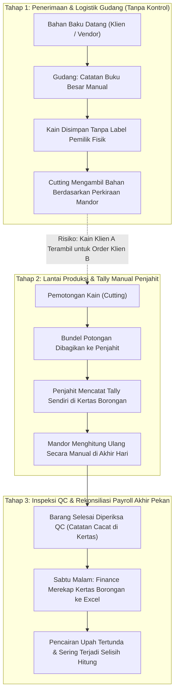
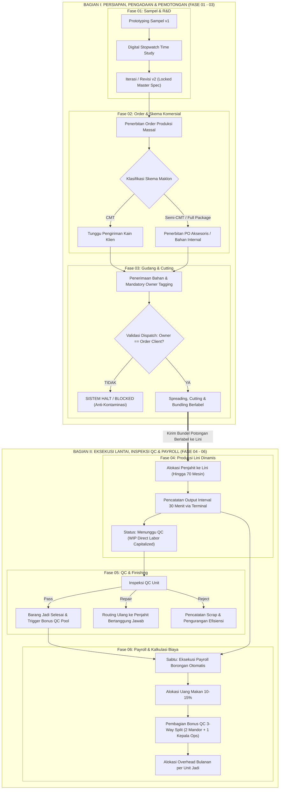
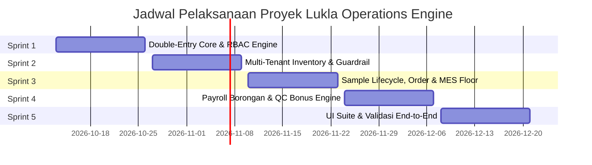

# BUSINESS REQUIREMENTS DOCUMENT (BRD)
## LUKLA OPERATIONS ENGINE

Nama Proyek: Lukla Operations Engine  
Entitas Bisnis: Lukla Manufacturing (Fasilitas Konveksi Ciwidey) x Snøhund  
Lokasi Fasilitas: Ciwidey, Kabupaten Bandung, Jawa Barat  
Versi Dokumen: 2.0.0  
Tanggal Rilis: 12 Oktober 2026  
Status Dokumen: Siap direview dan disetujui (Baseline v2)  
Klasifikasi: Rahasia Internal (Confidential), terbatas untuk pihak berwenang  

---

### RIWAYAT REVISI DOKUMEN

| Versi | Disetujui Oleh | Tanggal Revisi | Deskripsi Perubahan | Penulis / Analis |
| :--- | :--- | :--- | :--- | :--- |
| 0.1.0 | - | 12/10/2026 | Draft awal hasil bongkar slide pitch deck. | Engineering Team |
| 1.0.0 | Internal Lead | 12/10/2026 | Rilis v1: ringkasan gabungan BRD & PRD (79 baris). | Product Lead |
| 2.0.0 | Lead Solution Architect | 12/10/2026 | Disusun ulang total dengan format BRD enterprise 16 bab. Menambahkan model akuntansi kustodial double-entry, perbandingan proses As-Is dan To-Be, tabel kebutuhan yang lebih rapi, dampak ke neraca, dan lampiran rumus. | Solution Architect / Consulting Director |

---

## DAFTAR ISI

1. [Ringkasan Eksekutif](#1-ringkasan-eksekutif)
2. [Deskripsi Proyek](#2-deskripsi-proyek)
3. [Ruang Lingkup Proyek](#3-ruang-lingkup-proyek)
4. [Pendorong Bisnis](#4-pendorong-bisnis)
5. [Proses Operasional Saat Ini (As-Is)](#5-proses-operasional-saat-ini-as-is)
6. [Proses Operasional Usulan (To-Be)](#6-proses-operasional-usulan-to-be)
7. [Kebutuhan Fungsional](#7-kebutuhan-fungsional)
8. [Kebutuhan Non-Fungsional](#8-kebutuhan-non-fungsional)
9. [Dampak Laporan Keuangan & Neraca](#9-dampak-laporan-keuangan--neraca)
10. [Analisis Biaya & Manfaat](#10-analisis-biaya--manfaat)
11. [Kebutuhan Sumber Daya](#11-kebutuhan-sumber-daya)
12. [Jadwal, Tonggak Pencapaian & Tenggat Waktu](#12-jadwal-tonggak-pencapaian--tenggat-waktu)
13. [Asumsi & Batasan Bisnis](#13-asumsi--batasan-bisnis)
14. [Glosarium Terminologi](#14-glosarium-terminologi)
15. [Referensi Dokumen](#15-referensi-dokumen)
16. [Lampiran Teknis & Spesifikasi Sistem](#16-lampiran-teknis--spesifikasi-sistem)

---

## 1. RINGKASAN EKSEKUTIF

Lukla Manufacturing menjalankan pabrik konveksi pakaian di Ciwidey, Jawa Barat, dengan kapasitas fleksibel sampai sekitar 70 mesin jahit aktif. Modelnya hibrida: pabrik memproduksi merek sendiri, Snøhund, dan menerima jasa maklon (contract toll-manufacturing) dari berbagai merek fashion eksternal (B2B).

Hari ini, lantai produksi dan gudang Lukla punya tiga titik rawan:

1. Bahan antarklien tercampur (kontaminasi silang): Bahan baku Klien A bisa terpakai untuk pesanan Klien B karena sistem tidak punya pembatas. Akibatnya stok kurang, kontrak jadi sengketa, dan kerugiannya sulit dipulihkan.
2. Payroll borongan berantakan saat jumlah operator naik-turun (1 sampai 70+): Pabrik tidak menggaji bulanan tetap, melainkan upah borongan (piece-rate). Rekonsiliasi manual tiap Sabtu memakan lebih dari 8 jam dan gampang salah hitung. Uang makan (10% sampai 15%) berubah-ubah, pembagian bonus QC 3 arah lambat, dan overhead bulanan pabrik tidak bisa dibebankan secara adil ke tiap potong pakaian.
3. Jejak revisi prototipe hilang (R&D spec drift): Sampel belum tercatat digital, jadi hasil time study, spesifikasi kain, dan rate card komponen tersebar di catatan kertas. Saat order masuk produksi massal, biaya dan target jahit meleset dari rencana.

Lukla Operations Engine adalah platform manajemen operasional pabrik berbasis event-driven. Platform ini menghubungkan seluruh alur kerja (Sampel → Order → Gudang → Cutting → Jahit → QC → Payroll) di atas double-entry ledger yang immutable (tidak bisa diubah). Sistem memisahkan kepemilikan material lewat aturan program, mencatat hasil kerja lantai produksi tiap 30 menit, dan menghitung biaya komersial serta gaji secara otomatis tanpa spreadsheet manual.

---

## 2. DESKRIPSI PROYEK

Proyek ini membangun sistem inti (core operating engine) untuk konveksi garmen skala menengah di Indonesia. Kerja sama maklon Lukla terbagi dalam tiga skema komersial, dan skema itulah yang menentukan siapa pemilik fisik dan hukum atas bahan baku:

- Skema CMT (Cut, Make, Trim): Klien B2B menyediakan seluruh bahan baku utama (kain) dan bahan pembantu/aksesoris. Lukla hanya menyumbang tenaga kerja dan mesin untuk cutting, perakitan jahit (sewing assembly), dan finishing. Bahan klien berstatus titipan kustodial, bukan aset neraca Lukla.
- Skema Semi-CMT: Klien menyediakan bahan utama (kain luar/shell). Lukla mengadakan sisanya: bahan pembantu, furing, benang, kancing, dan resleting.
- Skema CMT + Bahan (Full Package): Lukla mengadakan semua bahan baku, kain, dan aksesoris, lalu memproduksi dari awal sampai akhir. Skema ini juga dipakai untuk merek internal Snøhund.

Platform ini menggantikan catatan kertas dan spreadsheet dengan satu sistem terpadu. Aturan integritas data berlaku pada setiap pergerakan barang dan pengakuan biaya tenaga kerja di lantai pabrik.

---

## 3. RUANG LINGKUP PROYEK

### 3.1 Dalam Ruang Lingkup (In Scope)

- Manajemen Multi-Tenant & Identitas Kepemilikan Material: Penandaan wajib pasangan client_id dan order_id pada setiap lot bahan baku, rol kain, bundel potongan, dan barang jadi.
- Validasi Anti-Kontaminasi Silang: Trigger di level basis data (database-level trigger) yang menolak pengeluaran material milik Klien X untuk pesanan Klien Y.
- Manajemen Siklus Sampel & R&D Time Study: Pelacakan versi prototipe (v1, v2, dan seterusnya), instrumen stopwatch digital pencatat waktu perakitan per komponen, penetapan konsumsi bahan, dan konversi spesifikasi master ke pesanan massal.
- Pelacakan Output Lantai per 30 Menit: Terminal layar sentuh bagi mandor untuk menginput jumlah hasil jahit per penjahit/komponen setiap 30 menit.
- Manajemen Alokasi Kapasitas Dinamis: Lini jahit fleksibel yang bisa menampung 1 sampai 70+ penjahit tanpa slot kaku.
- Inspeksi Kontrol Kualitas (QC) & Taksonomi Cacat: Klasifikasi unit menjadi Pass, Repair, atau Reject/Scrap beserta pencatatan jenis cacat garmen (broken stitch, puckering, uneven seam).
- Mesin Penggajian Borongan Mingguan:
  - Kalkulasi upah borongan penjahit: jumlah unit terverifikasi dikalikan rate komponen.
  - Perhitungan pool uang makan mengambang mingguan sebesar 10% sampai 15% dari total ongkos jahit.
  - Perhitungan bonus QC 3 arah yang dibagi rata untuk Mandor 1, Mandor 2, dan Kepala Operasional dari unit lolos QC.
  - Alokasi biaya overhead operasional bulanan pabrik ke per unit pakaian jadi.
- Portal Eksternal Klien B2B: Klien maklon memantau sendiri status pesanan, milestone, dan saldo stok bahan titipan mereka, tanpa bisa melihat data klien lain.
- Matriks Tata Kelola & Kontrol Akses (RBAC): Pengaturan hak akses untuk 8 peran pengguna.

### 3.2 Di Luar Ruang Lingkup (Out of Scope)

- Kompensasi Ketenagakerjaan Statuter: Perhitungan potongan BPJS Ketenagakerjaan/Kesehatan, pajak penghasilan PPh 21, uang lembur formal, dan pesangon formal (lingkup terbatas pada upah borongan dan tunjangan makan operasional).
- Akuntansi Finansial Lengkap: Pelaporan pajak korporasi, depresiasi aset gedung/mesin, dan rekonsiliasi perbankan multi-rekening eksternal.
- Logistik Pengiriman & Armada Kendaraan: Pelacakan armada truk ekspedisi pihak ketiga atau integrasi API kurir logistik eksternal.
- Pengadaan Bahan Baku Terotomatisasi (MRP): Pembelian kain otomatis ke supplier tekstil. Sistem hanya mencatat purchase order internal.
- Aplikasi Seluler Native: Sistem berupa web responsive (PWA) untuk desktop dan tablet sentuh industri.

---

## 4. PENDORONG BISNIS

| No | Pendorong Bisnis | Dampak Strategis & Finansial |
| :--- | :--- | :--- |
| BD-1 | Proteksi Aset Kustodial & Kepatuhan Kontrak Maklon | Menghilangkan risiko tuntutan hukum dan ganti rugi akibat kain titipan klien terpakai untuk pesanan lain. Merek fashion besar jadi lebih percaya menitipkan volume produksi maklon bernilai tinggi ke Lukla. |
| BD-2 | Efisiensi Administrasi & Akurasi Gaji Mingguan | Menghapus rekap manual akhir pekan yang menyita 8 sampai 10 jam kerja tim keuangan, dan mengakhiri sengketa jumlah jahitan borongan dengan operator. |
| BD-3 | Optimalisasi Throughput & Visibilitas Lantai Pabrik | Pemantauan tidak lagi pasif lewat catatan harian, tapi aktif tiap 30 menit. Penumpukan (bottleneck) komponen terlihat dalam hitungan jam. |
| BD-4 | Standarisasi Biaya Pokok Produksi (COGS Precision) | Biaya riil per potong pakaian jadi terhitung akurat (bahan baku riil + ongkos jahit terverifikasi + alokasi overhead bulanan riil), sehingga penawaran kontrak maklon baru tidak underpricing. |

---

## 5. PROSES OPERASIONAL SAAT INI (AS-IS)

Saat ini seluruh operasional pabrik Ciwidey bertumpu pada dokumen kertas (surat jalan, travel card bundel, kartu borongan) dan spreadsheet yang terpisah-pisah:



Titik masalah utama alur As-Is:

1. Penerimaan Gudang: Stok titipan klien bercampur dengan kain Snøhund di rak yang sama. Tidak ada identitas di sistem yang bisa mencegah salah keluar barang.
2. Lantai Produksi: Penjahit menghitung sendiri hasilnya di kartu kertas. Angka sering digelembungkan atau lembar kartu borongan hilang.
3. Audit QC: Cacat baru ketahuan di tahap akhir, dan tidak bisa dilacak penjahit mana yang mengerjakan komponen cacat itu.
4. Rekonsiliasi Payroll: Tiap Sabtu sore tim finance merekap data borongan sekitar 70 penjahit di Excel secara manual, lengkap dengan rumus uang makan dan bonus mandor. Salah ketik formula gampang terjadi.

---

## 6. PROSES OPERASIONAL USULAN (TO-BE)

Proses baru ini mengubah pabrik menjadi satu alur terpadu dengan 6 fase:



---

## 7. KEBUTUHAN FUNGSIONAL

### 7.1 Skala Prioritas Kebutuhan

Sesuai template BRD, semua kebutuhan fungsional dikelompokkan dalam skala prioritas 1 sampai 5:

| Nilai | Tingkat | Deskripsi Operasional |
| :---: | :--- | :--- |
| 1 | Critical | Harus ada saat peluncuran perdana. Jika fungsi ini gagal, sistem tidak bisa beroperasi atau integritas finansial/kustodial terlanggar. |
| 2 | High | Sangat penting bagi keberhasilan proyek, tapi sistem masih bisa jalan terbatas dalam skenario Minimum Viable Product (MVP). |
| 3 | Medium | Menambah efisiensi operasional secara berarti, boleh dirilis di iterasi berikutnya. |
| 4 | Low | Fitur pelengkap untuk kenyamanan. Keberhasilan proyek tidak bergantung padanya. |
| 5 | Future | Di luar rilis saat ini, dicatat sebagai rencana jangka panjang. |

---

### 7.2 Matriks Kategori Kebutuhan Fungsional

#### Kategori RC1: Manajemen Multi-Tenant & Keamanan Akses (RBAC & Tenancy)

| ID | Deskripsi Kebutuhan Fungsional | Prioritas | Diusulkan Oleh |
| :--- | :--- | :---: | :--- |
| FR-1.1 | Sistem harus mengisolasi seluruh data operasional dan inventaris per tenant, sehingga klien B2B tidak bisa mengakses data klien lain. | 1 (Critical) | Owner & Legal |
| FR-2.1 | Sistem harus menerapkan kontrol akses berbasis peran (RBAC) untuk 8 peran pengguna, dengan batas tegas antara pencatatan operasional dan penyesuaian finansial. | 1 (Critical) | Executive Management |
| FR-3.1 | Sistem harus mencatat semua riwayat revisi dan transaksi dalam audit trail append-only. Transaksi yang sudah terkunci tidak boleh diubah, bahkan oleh Owner. | 1 (Critical) | Finance & Auditor |

#### Kategori RC2: Siklus Sampel, Time Study & R&D Garmen

| ID | Deskripsi Kebutuhan Fungsional | Prioritas | Diusulkan Oleh |
| :--- | :--- | :---: | :--- |
| FR-4.1 | Sistem harus mengelola versi sampel prototipe (v1 → v2 → Approved Master Spec) dan menyimpan riwayat perubahan parameter jahitan serta spesifikasi kain. | 2 (High) | Tim Sample / Adis |
| FR-4.2 | Sistem harus punya alat pencatat time study (stopwatch digital) per komponen garmen untuk menghitung waktu standar kerja. | 2 (High) | Kepala Produksi |
| FR-4.3 | Sistem harus menghasilkan Master Spec Sheet terkunci begitu klien menyetujui sampel, lalu menurunkan struktur komponennya ke pesanan massal. | 1 (Critical) | Tim Sample & Owner |

#### Kategori RC3: Manajemen Gudang, Bahan Kustodial & Cutting

| ID | Deskripsi Kebutuhan Fungsional | Prioritas | Diusulkan Oleh |
| :--- | :--- | :---: | :--- |
| FR-5.1 | Sistem harus mewajibkan pengisian pemilik (client_id) dan alokasi pesanan (order_id) saat bahan baku kain diterima, baik kain titipan maupun kain milik perusahaan. | 1 (Critical) | Warehouse Manager |
| FR-5.2 | Sistem harus bisa mencatat penerimaan bahan titipan tanpa menjadikannya hutang dagang lancar perusahaan. | 1 (Critical) | Finance Officer |
| FR-6.1 | Sistem harus mengelola stok opname dan saldo rol kain secara real-time per lot inventaris. | 2 (High) | Warehouse Manager |
| FR-6.2 | Anti-Cross Contamination Engine: Sistem harus otomatis memblokir pengeluaran kain/bahan baku ke lantai cutting jika client_id pemilik bahan berbeda dengan client_id pemesan order kerja. | 1 (Critical) | Executive & B2B Clients |
| FR-6.3 | Sistem harus mencatat hasil cutting massal, rasio limbah kain (cutting scrap), dan efisiensi pemakaian bahan dibanding pola sampel. | 2 (High) | Kepala Produksi |

#### Kategori RC4: Eksekusi Lantai Produksi (Shop Floor MES)

| ID | Deskripsi Kebutuhan Fungsional | Prioritas | Diusulkan Oleh |
| :--- | :--- | :---: | :--- |
| FR-7.1 | Sistem harus mendukung tata letak lini produksi yang dinamis dan penempatan penjahit yang fleksibel (1 sampai 70+ mesin), tanpa konfigurasi slot kaku. | 1 (Critical) | Kepala Produksi / Mandor |
| FR-7.2 | Sistem harus mengelola rate card ongkos jahit per komponen artikel berdasarkan hasil time study, dan mendukung tarif berbeda antarklien untuk artikel yang sama. | 1 (Critical) | Owner & Kepala Produksi |
| FR-7.3 | Sistem harus menyediakan terminal layar sentuh bagi mandor untuk menginput jumlah hasil jahit per penjahit/komponen dalam blok interval 30 menit. | 1 (Critical) | Mandor (Line Floor) |
| FR-7.4 | Setiap unit komponen yang tercatat di terminal interval 30 menit harus otomatis berstatus Menunggu QC, dan operatornya mendapat hak upah bersyarat. | 1 (Critical) | Mandor & Finance |

#### Kategori RC5: Kontrol Kualitas (QC) & Penanganan Cacat

| ID | Deskripsi Kebutuhan Fungsional | Prioritas | Diusulkan Oleh |
| :--- | :--- | :---: | :--- |
| FR-8.1 | Sistem harus menyediakan terminal QC untuk mengklasifikasikan unit garmen selesai: Pass (Lolos), Repair (Perbaikan), atau Reject/Scrap (Afkir). | 1 (Critical) | QC Inspector |
| FR-8.2 | Sistem harus mewajibkan QC memilih jenis cacat (broken stitch, puckering, uneven seam, kotoran minyak) saat unit ditandai Repair atau Reject. | 2 (High) | QC Inspector & Head Ops |
| FR-8.3 | Sistem harus mengembalikan unit Repair ke antrean penjahit yang mengerjakan komponen tersebut, tanpa menambah kredit upah borongan dua kali. | 1 (Critical) | Kepala Produksi |

#### Kategori RC6: Mesin Penggajian Fleksibel & Penetapan Biaya (Payroll & Costing)

| ID | Deskripsi Kebutuhan Fungsional | Prioritas | Diusulkan Oleh |
| :--- | :--- | :---: | :--- |
| FR-10.1 | Sistem harus menghitung upah borongan mingguan penjahit secara otomatis tiap Sabtu: akumulasi unit terverifikasi dikali rate card komponen. | 1 (Critical) | Finance & Payroll |
| FR-10.2 | Sistem harus menghitung pool uang makan mingguan: persentase yang diatur manual (10% sampai 15%) dikali total ongkos jahit periode berjalan. | 1 (Critical) | Finance & Payroll |
| FR-10.3 | Sistem harus mengumpulkan dana bonus QC dari semua unit berstatus Pass, lalu membaginya rata menjadi 3 bagian (Mandor 1, Mandor 2, Kepala Operasional) dengan pembulatan ke bawah. | 1 (Critical) | Executive & Mandor |
| FR-10.4 | Sistem harus merekap total biaya overhead pabrik bulanan (listrik, air, internet, sewa gedung) dan menghitung alokasi overhead per unit garmen jadi. | 2 (High) | Finance Officer & Owner |

---

## 8. KEBUTUHAN NON-FUNGSIONAL

| ID | Kategori NFR | Spesifikasi Kebutuhan Teknis & Kriteria Keberhasilan |
| :--- | :--- | :--- |
| NFR-01 | Multi-Tenant Data Isolation | Data antarklien dipisahkan secara logis di tingkat basis data. Kueri portal klien wajib memuat predikat WHERE client_id = :auth_client_id. Toleransi kebocoran data antar-tenant: 0%. |
| NFR-02 | Ledger Immutability & Auditability | Setiap pergerakan barang dan akrual upah wajib dicatat secara append-only. Pembatalan hanya lewat transaksi pembalik, tanpa UPDATE atau DELETE langsung pada tabel buku besar fisik. |
| NFR-03 | Floor Terminal Response Time | Antarmuka terminal sentuh interval 30 menit di lantai produksi harus merespons maksimal 500 milidetik untuk tombol tambah/kurang (+ / -), agar mandor tidak mengantre saat pergantian shift. |
| NFR-04 | Concurrency & Ingestion Throughput | Basis data harus sanggup menerima penulisan bersamaan dari minimal 10 lini jahit aktif (70 stasiun operator) saat interval 30 menit ditutup, tanpa deadlock. |
| NFR-05 | Offline Tolerance / Network Resilience | Terminal lantai produksi harus tahan gangguan jaringan (local cache / optimistic UI). Saat WiFi pabrik putus sementara, mandor tetap bisa menginput tally, dan data tersinkron otomatis begitu koneksi pulih. |
| NFR-06 | Perangkat & Kompatibilitas Layar Sentuh | Semua antarmuka terminal lantai dan terminal QC harus memakai tombol minimal 48 x 48 piksel, supaya nyaman ditekan jari di tablet layar sentuh resolusi standar (1024 x 768 piksel ke atas). |

---

## 9. DAMPAK LAPORAN KEUANGAN & NERACA

Lukla Operations Engine akan langsung memengaruhi pembukuan dan neraca Lukla Manufacturing:

### 9.1 Perlakuan Akuntansi Persediaan Kustodial vs Aset Perusahaan

Kelemahan terbesar pencatatan konvensional: kain titipan klien bercampur dengan persediaan aset pabrik. Ini mendistorsi nilai likuiditas di neraca dan berisiko hukum berat (dalam sengketa kepailitan, kain milik klien tidak boleh disita sebagai aset Lukla).

#### 1. Pada Skema CMT (Bahan Titipan Klien)
Bahan baku masuk dicatat di akun persediaan titipan, di luar aset lancar perusahaan (Off-Balance Sheet / Custodial Ledger):

$$
\text{Debit: Persediaan Kustodial Titipan [Klien ID]} \quad / \quad \text{Kredit: Liabilitas Kustodial Klien [Klien ID]}
$$

Mutasi ini tidak menambah aset lancar Lukla dan tidak menimbulkan hutang dagang ke supplier kain.

#### 2. Pada Skema Full Package / Snøhund (Bahan Milik Perusahaan)
Pembelian kain dicatat resmi sebagai aset lancar perusahaan:

$$
\text{Debit: Persediaan Bahan Baku (Aset Lancar)} \quad / \quad \text{Kredit: Hutang Usaha / Kas}
$$

#### 3. Kapitalisasi Biaya Tenaga Kerja Langsung (WIP Transformation)
Setiap kali mandor memverifikasi output interval 30 menit di lini jahit, nilai jasa tenaga kerja langsung dikapitalisasi ke persediaan barang dalam proses:

$$
\text{Debit: Persediaan Barang Dalam Proses (WIP Tenaga Kerja) [Order ID]} \quad / \quad \text{Kredit: Beban Akrual Gaji Terutang [Operator ID]}
$$

### 9.2 Dampak Arus Kas & Modal Kerja

Kalkulasi Cost of Goods Sold (COGS) dan pembebanan overhead per unit yang otomatis memungkinkan faktur ke klien maklon terbit seketika saat QC menyatakan barang lolos. Siklus konversi kas pun turun dari rata-rata 35 hari menjadi di bawah 14 hari.

---

## 10. ANALISIS BIAYA & MANFAAT

### 10.1 Estimasi Biaya Proyek

1. Pengadaan Perangkat Keras Lantai:
   - 4 unit tablet Android industri layar sentuh 10 inci untuk terminal mandor lini jahit.
   - 2 unit tablet/terminal kerja untuk pos penerimaan gudang dan pos inspeksi QC.
   - Pemasangan 2 unit Access Point WiFi High-Density tahan debu konveksi di area lantai pabrik Ciwidey.
2. Biaya Pengembangan & Implementasi Perangkat Lunak:
   - Tim engineering perangkat lunak (Backend Engine, Frontend React/PWA, Database Architect).
   - Biaya infrastruktur server cloud / local edge gateway di fasilitas Ciwidey.
3. Biaya Pelatihan & Manajemen Perubahan:
   - Pelatihan 1 minggu untuk mandor, staf gudang, inspektur QC, dan tim keuangan.

### 10.2 Manfaat Berwujud & Tak Berwujud

| Kategori | Manfaat Operasional & Finansial | Estimasi Dampak Terukur |
| :--- | :--- | :--- |
| Berwujud (Tangible) | Kerugian salah potong bahan klien hilang | Mencegah ganti rugi kain klien akibat salah potong (rata-rata Rp 15.000.000 sampai Rp 40.000.000 per insiden kontaminasi). |
| Berwujud (Tangible) | Rekonsiliasi payroll Sabtu lebih hemat waktu | Kerja staf Finance turun dari 8 jam manual menjadi kurang dari 15 menit per minggu lewat eksekusi sistem otomatis. |
| Berwujud (Tangible) | Penggelembungan output borongan berhenti | Klaim hasil jahit fiktif tercegah lewat verifikasi mandor tiap 30 menit (menutup kebocoran upah 5% sampai 8%). |
| Tak Berwujud (Intangible) | Kepercayaan merek B2B eksternal naik | Klien maklon bisa melihat progres pengerjaan dan sisa stok kain mereka lewat portal mandiri. |
| Tak Berwujud (Intangible) | Data R&D sampai produksi massal konsisten | Spesifikasi sampel yang disetujui Tim Sampel tidak lagi melenceng di produksi massal. |

---

## 11. KEBUTUHAN SUMBER DAYA

### 11.1 Personel & Struktur Organisasi Proyek

- Internal Executive / Sponsor Proyek: Menentukan kebijakan bisnis dan batas otorisasi rate card.
- Kepala Pabrik / Head of Operations: Pemilik proses bisnis di lapangan, bertanggung jawab atas adopsi oleh mandor.
- Lead System Architect & Tech Lead: Bertanggung jawab atas integritas database, logika akuntansi double-entry, dan arsitektur aplikasi.
- Tim Sample (Adis Sample Lead): Menguji modul time study dan siklus sampel garmen.
- Mandor & Perwakilan Penjahit: Mencoba terminal sentuh lantai produksi.

### 11.2 Kebutuhan Perangkat Keras & Infrastruktur Pabrik

- Terminal Mandor: Tablet sentuh minimal 10 inci, dengan pelindung benturan dan debu tekstil.
- Jaringan Komunikasi: LAN/WiFi yang menjangkau area gudang bahan, area potong, lini jahit 1 sampai 3, dan pos QC.
- Stasiun Kerja Finance & Admin: 2 PC desktop standar untuk master data, konfigurasi skema, dan pencairan payroll.

---

## 12. JADWAL, TONGGAK PENCAPAIAN & TENGGAT WAKTU

Proyek berjalan dalam 5 sprint bertahap:



Tonggak Pencapaian Kritis (Major Milestones):

- Milestone 1 (26 Okt 2026): Fondasi basis data double-entry, skema akun akuntansi, dan middleware RBAC 8 peran lulus unit-test.
- Milestone 2 (09 Nov 2026): Skenario 1 (pencegahan kontaminasi silang stok multi-tenant) lulus validasi di level basis data.
- Milestone 3 (23 Nov 2026): Spesifikasi sampel v2 berhasil menjadi pesanan massal Semi-CMT, lengkap dengan rate card dan time study yang diwariskan.
- Milestone 4 (07 Des 2026): Formula payroll Sabtu (borongan + uang makan 10% sampai 15% + bonus QC 3 arah) terbukti presisi.
- Milestone 5 (21 Des 2026): Uji coba menyeluruh 6 antarmuka di lantai pabrik Ciwidey selesai; sistem siap Go-Live.

---

## 13. ASUMSI & BATASAN BISNIS

### 13.1 Asumsi Operasional

1. Skala Kapasitas: Sekitar 70 mesin jahit adalah volume operasional pabrik Ciwidey saat ini, bukan batas kaku arsitektur perangkat lunak.
2. Kepatuhan Input Mandor: Mandor diasumsikan disiplin menginput verifikasi unit di terminal sentuh setiap 30 menit.
3. Formula Uang Makan: Persentase uang makan ada di rentang 10% sampai 15%, ditetapkan manual oleh tim Finance di awal tiap siklus minggu produksi.
4. Pembagian Bonus QC 3 Arah: Bonus QC dibagi rata untuk 3 orang (2 Mandor Lini + 1 Kepala Operasional), sesuai kesepakatan manajemen internal saat ini.

### 13.2 Batasan Sistemik

1. Larangan Manipulasi Historis: Catatan buku besar yang sudah direkonsiliasi dan dikunci tidak bisa diubah sama sekali, bahkan oleh akun Owner/Eksekutif.
2. Ketergantungan Alur Data: Surat perintah kerja potong wajib merujuk ke lot bahan baku yang valid dan sudah terverifikasi di gudang.
3. Penyelarasan Nilai Pecahan: Pembagian rupiah untuk bonus QC dan alokasi overhead wajib dibulatkan ke bawah (floor integer rounding). Sisa pembulatan masuk ke pos cadangan operasional.

---

## 14. GLOSARIUM TERMINOLOGI

| Istilah Domain | Padanan Bahasa Inggris | Definisi Operasional dalam Sistem Lukla |
| :--- | :--- | :--- |
| Maklon | Toll / Contract Manufacturing | Model kerja sama di mana klien B2B menyerahkan produksi pakaian kepada Lukla di bawah salah satu skema komersial (CMT, Semi-CMT, Full Package). |
| CMT (Cut, Make, Trim) | Cut, Make, Trim | Skema maklon di mana klien menyediakan 100% bahan baku dan aksesoris; Lukla hanya menyediakan jasa potong, jahit, dan finishing. |
| Semi-CMT | Semi-CMT | Skema maklon di mana klien menyediakan kain utama; Lukla menyediakan bahan pembantu, furing, benang, dan aksesoris. |
| CMT + Bahan (Full Package) | Full Package | Skema di mana Lukla menyediakan seluruh bahan baku dan jasa produksi (juga digunakan untuk brand internal Snøhund). |
| Konveksi | Garment Manufacturing | Fasilitas produksi pakaian skala kecil/menengah milik Lukla di Ciwidey dengan kapasitas sekitar 70 mesin jahit. |
| Borongan | Piece-Rate Work | Sistem kompensasi kerja di mana penjahit dibayar berdasarkan jumlah komponen unit fisik yang berhasil diselesaikan, bukan upah harian/bulanan. |
| Mandor | Floor Foreperson / Supervisor | Pengawas lini produksi yang bertugas mengatur penempatan penjahit, menentukan rate card komponen, dan memverifikasi tally output per 30 menit. |
| Penjahit | Sewing Operator / Tailor | Tenaga kerja pelaksana penjahitan komponen pakaian di lini produksi. |
| Uang Makan | Meal Allowance | Tunjangan makan mingguan yang dihitung sebesar 10% sampai 15% dari total akumulasi ongkos jahit penjahit dalam satu periode. |
| Ongkos Jahit | Sewing Fee / Piece Wage Base | Nilai akumulasi tarif jahit yang dihasilkan dari seluruh komponen terverifikasi dalam satu periode produksi. |
| Rate Card | Piece-Rate Tariff Card | Tabel tarif upah per komponen garmen yang ditetapkan berdasarkan hasil pengukuran time study dan negosiasi kontrak klien. |
| Time Study | Time Study / SMV | Pengukuran durasi waktu standar pengerjaan suatu komponen garmen menggunakan instrumen stopwatch digital pada fase sampel. |
| Stok Opname | Physical Inventory Audit | Penghitungan fisik berkala atas persediaan kain dan aksesoris di gudang untuk dicocokkan dengan saldo sistem. |
| Titipan / Konsinyasi | Consigned Inventory | Bahan baku milik klien yang disimpan di gudang Lukla di bawah skema CMT/Semi-CMT (berstatus liabilitas kustodial). |
| Kontaminasi Silang | Cross-Contamination | Kesalahan fatal ketika bahan titipan Klien A terpakai untuk memproduksi pesanan Klien B. |
| Menunggu QC | Awaiting QC | Status barang dalam proses (WIP) setelah selesai dijahit dan menunggu pemeriksaan akhir oleh petugas QC. |

---

## 15. REFERENSI DOKUMEN

1. Slide Pitch Deck Lukla Operations Engine (Slide 00 sampai 09): Sumber spesifikasi kebutuhan fungsional dan model operasional konveksi Ciwidey.
2. OpenSpec Architecture Blueprint: openspec/changes/lukla-ops-engine-planning/artifacts/overall-plan-draft.md (Spesifikasi domain model akuntansi double-entry dan rancangan arsitektur sistem).
3. OpenSpec Source Deconstruction & Traceability Register: openspec/changes/lukla-ops-engine-planning/artifacts/00-deconstruction.md.
4. Standard Operating Procedure (SOP) Produksi Konveksi Lukla: SOP penerimaan bahan kain, pemotongan (cutting), dan quality inspection garmen.

---

## 16. LAMPIRAN TEKNIS & SPESIFIKASI SISTEM

### Lampiran 16.1: Formulasi Matematis Perhitungan Payroll & Biaya

#### 1. Upah Borongan Mingguan Penjahit
Dihitung tiap Sabtu untuk setiap penjahit i:

$$
\text{Wage}_i = \sum_{c=1}^{C} (Q_{i, c, \text{verified}} \times R_{c})
$$

Keterangan parameter:
- Q_i,c,verified: Total unit komponen c yang terverifikasi pada interval 30 menit untuk penjahit i.
- R_c: Tarif upah borongan komponen c berdasarkan rate card aktif.

#### 2. Pool Uang Makan Mengambang
Dihitung secara terpusat untuk alokasi makan penjahit:

$$
\text{Pool}_{\text{meal}} = \mu \times \sum_{i=1}^{N} \text{Wage}_i
$$

Keterangan parameter:
- mu: Persentase yang diatur manual oleh Finance di tiap siklus, rentang 0.10 sampai 0.15 (10% sampai 15%).
- N: Jumlah penjahit aktif yang memiliki catatan output terverifikasi.

#### 3. Tiga Bagian Bonus Kontrol Kualitas
Dikumpulkan dari semua pakaian yang dinyatakan Pass oleh pos QC, lintas order dan klien:

$$
\text{Pool}_{\text{QC}} = U_{\text{passed, total}} \times R_{\text{bonus\_per\_pc}}
$$

Dibagi rata untuk tiga posisi pimpinan lapangan:

$$
\text{Bonus}_{\text{Mandor 1}} = \text{Bonus}_{\text{Mandor 2}} = \text{Bonus}_{\text{Kepala Ops}} = \left\lfloor \frac{\text{Pool}_{\text{QC}}}{3} \right\rfloor
$$

Keterangan: Sisa pembulatan dialokasikan ke pos cadangan operasional pabrik.

#### 4. Alokasi Biaya Overhead Pabrik per Unit Pakaian
Dihitung saat tutup buku bulanan:

$$
\text{Overhead}_{\text{unit}} = \frac{\sum \text{Biaya}_{\text{operasional pabrik bulanan}}}{U_{\text{total unit jadi diproduksi dalam bulan berjalan}}}
$$

Keterangan: Biaya operasional bulanan mencakup listrik, air, internet, dan sewa fasilitas pabrik.

---

### Lampiran 16.2: Logika Basis Data Anti-Kontaminasi Silang (PostgreSQL Trigger)

Segregasi inventaris ditegakkan di level transaksi basis data, sebelum mutasi material disimpan:

```sql
CREATE OR REPLACE FUNCTION validate_material_dispatch()
RETURNS TRIGGER AS $$
DECLARE
    target_order_client_id UUID;
    source_stock_client_id UUID;
BEGIN
    -- Mengambil ID Klien pemilik pesanan target
    SELECT client_id INTO target_order_client_id 
    FROM mass_production_orders 
    WHERE id = NEW.destination_order_id;

    -- Mengambil ID Klien pemilik lot bahan yang akan dikeluarkan
    SELECT client_id INTO source_stock_client_id 
    FROM warehouse_inventory_lots 
    WHERE id = NEW.source_lot_id;

    -- Evaluasi integritas kepemilikan multi-tenant
    IF target_order_client_id <> source_stock_client_id THEN
        RAISE EXCEPTION 'CRITICAL VIOLATION (FR-6.2): Upaya pengeluaran bahan milik Klien % untuk Pesanan % milik Klien % DITOLAK.',
            source_stock_client_id, NEW.destination_order_id, target_order_client_id;
    END IF;

    RETURN NEW;
END;
$$ LANGUAGE plpgsql;
```

---

### Lampiran 16.3: Spesifikasi Wireframe 6 Minimum Required UI Views

Sistem menyediakan 6 antarmuka khusus:

```
+-----------------------------------------------------------------------------------+
| VIEW 01: Executive Operations Dashboard                                           |
| [Status Lini: 62/70 Aktif] [Klien Berjalan: Snøhund, Klien-B] [Kecepatan: 94%]    |
| +-----------------------------------------------+ +-------------------------------+|
| | Grafik Output Kecepatan Interval 30 Menit     | | Matriks Progres Order Klien   ||
| +-----------------------------------------------+ +-------------------------------+|
+-----------------------------------------------------------------------------------+
| VIEW 02: Sample & Time Study Tracker                                              |
| Artikel: Arctic Parka | Versi Aktif: [v2 (Terkunci)] | Riwayat: [v1 Diarsipkan]    |
| [Stopwatch Komponen: Jahit Kerah | Waktu: 00:04:12.4] -> [Simpan ke Time Study]   |
+-----------------------------------------------------------------------------------+
| VIEW 03: Multi-Client Warehouse Inventory Grid                                    |
| [Filter Klien: Semua] [Cari Tag Lot: LOT-2026-99] [Peringatan Tabrakan: 0]        |
| Item: Kain Taslan | Pemilik: Snøhund | Alokasi: ORD-401 | Saldo: 420m | [Keluarkan]|
| *CATATAN*: Memilih pengeluaran ke Order klien lain memicu pop-up blokir sistem    |
+-----------------------------------------------------------------------------------+
| VIEW 04: Floor Terminal (Antarmuka Sentuh Interval 30 Menit)                      |
| Lini: Lini 03 | Mandor: Budi | Interval: [13:30 - 14:00]                         |
| +-------------------------+ +-------------------------+ +-------------------------+|
| | Penjahit #14: Rudi S.   | | Penjahit #22: Asep M.   | | Penjahit #31: Dede K.   ||
| | Jahit Lengan            | | Pasang Resleting Depan  | | Tindas Kerah            ||
| | [-]  [  14 pcs  ]  [+]  | | [-]  [   8 pcs  ]  [+]  | | [-]  [  12 pcs  ]  [+]  ||
| +-------------------------+ +-------------------------+ +-------------------------+|
|                                                       [ SUBMIT BLOK INTERVAL ]    |
+-----------------------------------------------------------------------------------+
| VIEW 05: QC Inspection Terminal                                                   |
| Order: ORD-401 (Snøhund) | Nomor Serial Unit: SN-401-0891                         |
| Status Tindakan:   [ (A) LOLOS (PASS) ]  [ (B) REPAIR ]   [ (C) REJECT / SCRAP ]  |
| Taksonomi Cacat:   [ ] Jahitan Loncat     [ ] Kerutan     [ ] Sambungan Tidak Rata|
+-----------------------------------------------------------------------------------+
| VIEW 06: Payroll & Costing Workspace                                              |
| Siklus: Minggu 41 (Penutupan Sabtu) | Penjahit Diproses: 68 Tenaga Kerja          |
| Total Borongan Murni: Rp 42.150.000 | Uang Makan (12.5%): Rp 5.268.750            |
| Unit Lolos QC: 2.800 pcs            | Dana Bonus QC: Rp 2.800.000 (Dibagi 3)      |
| Alokasi Beban Overhead Pabrik Bulanan: Rp 4.120 / unit pakaian                    |
|                                                  [ EKSEKUSI PEMBAYARAN PAYROLL ]  |
+-----------------------------------------------------------------------------------+
```

---

### Lampiran 16.4: Empat Skenario Pengujian Penerimaan Bisnis (Acceptance Test Scenarios)

1. Skenario 01: Pencegahan Kontaminasi Silang Bahan Baku Multi-Tenant
   - Aksi: Petugas gudang mencoba mengeluarkan 50 meter kain Taslan berlabel client_id: Klien_A untuk order potong order_id: ORD-Klien_B.
   - Perilaku Sistem Diharapkan: Transaksi langsung gagal di basis data, muncul notifikasi pemilik tidak cocok, dan insiden tercatat di log audit keamanan.
2. Skenario 02: Penambahan Tenaga Kerja Dinamis di Tengah Minggu
   - Aksi: Hari Kamis, 5 penjahit baru didaftarkan langsung ke lantai produksi. Mandor mencatat hasil mereka lewat terminal 30 menit pada Kamis dan Jumat. Payroll Sabtu dijalankan.
   - Perilaku Sistem Diharapkan: Upah borongan 5 penjahit baru terhitung otomatis tanpa me-restart siklus produksi, dan nilainya ikut masuk ke kalkulasi pool uang makan 10% sampai 15%.
3. Skenario 03: Pembagian Rata 3 Arah Bonus QC
   - Aksi: Akumulasi produksi lintas klien menghasilkan 3.000 unit berstatus Pass.
   - Perilaku Sistem Diharapkan: Sistem mengalikan 3.000 unit dengan tarif bonus per unit, lalu membagi dananya menjadi 3 bagian sama besar untuk Mandor 1, Mandor 2, dan Kepala Operasional, dibulatkan ke bawah.
4. Skenario 04: Transisi Revisi Sampel v1 ke v2 ke Pesanan Massal Semi-CMT
   - Aksi: Tim sampel membuat prototipe jaket v1, menginput time study, merevisi jahitan jadi v2, mengunci v2, lalu menerbitkan pesanan massal skema Semi-CMT.
   - Perilaku Sistem Diharapkan: Sistem membuat pesanan massal yang mewarisi spesifikasi dan rate card v2, membuka akun kustodial untuk kain utama dari klien, dan menjadwalkan PO internal untuk aksesoris.
