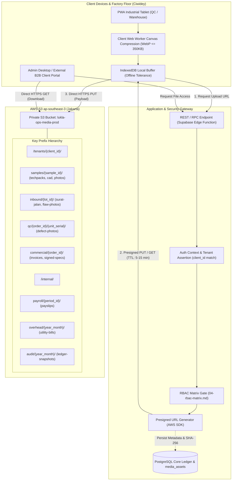

# [DRAFT / INITIAL] Lukla Operations Engine — Object Storage (S3) & Media Architecture Blueprint

> **Status:** INITIAL DRAFT / BRAINSTORMING PROPOSAL  
> **Date:** 13 Oktober 2026  
> **Context:** Phase 2 Technical Planning & Architectural Spike  
> **Source Documents Grounding:**
> - [`overall-plan-draft.md`](overall-plan-draft.md)
> - [`Lukla Operations Engine - BRD v2.2.1 - FINAL.md`](Lukla%20Operations%20Engine%20-%20BRD%20v2.2.1%20-%20FINAL.md) (Internal v2.3.0)
> - [`04-rbac-matrix.md`](04-rbac-matrix.md)
> - [`backend_database_structure.md`](backend_database_structure.md)

---

## 1. Executive Summary & Design Principles

Lukla Manufacturing operates a hybrid apparel konveksi in Ciwidey, West Java (~70 sewing machines) fulfilling both internal brand production (Snøhund) and contract manufacturing (Maklon B2B under CMT, Semi-CMT, and Full-Package schemes).

While the core ledger engine (`PostgreSQL` / immutable double-entry) manages state transitions, financial transactions, and multi-tenant inventory lots, the operations engine naturally generates unstructured physical artifacts (CAD markers, tech packs, camera photos of fabric defects, scanned Surat Jalan, weekly payslips, commercial invoices).

### Core Architectural Principles (Simplicity Ladder & Boring Technology)
1. **Single Bucket Multi-Tenancy:** Avoid dynamic bucket sprawl (no AWS bucket-per-client). Partition strictly via object key prefixes (`/tenants/{client_id}/...`) inside a single private bucket.
2. **Zero Direct Public Access & No AWS Keys on Devices:** Industrial tablets in Ciwidey and external B2B clients never receive AWS credentials or public S3 URLs. Access is mediated 100% via short-lived Presigned URLs issued after PostgreSQL session and RBAC evaluation.
3. **Ciwidey Edge Tolerance (Bandwidth & Intermittent Network):** Factory tablet cameras produce high-resolution JPEGs (5–12 MB). Uncompressed concurrent uploads over rural WiFi will saturate the network and stall the shop floor. All camera inputs must undergo client-side Web Worker canvas compression ($\le 350\text{ KB}$ WebP) and IndexedDB-buffered upload queues.
4. **Relational Metadata Coupling:** S3 stores only immutable binary blobs. Relational integrity, ownership, and double-entry cryptographic linking (SHA-256 checksums) remain in PostgreSQL.

---

## 2. File Artifact Taxonomy: Candidate Files for S3

Candidate files mapped across the **six operational phases** defined in the BRD:

| Phase & FR ID | Candidate Artifact | Format & File Size | Authorized Roles ([`04-rbac-matrix.md`](04-rbac-matrix.md)) | Storage Tier & Retention Policy |
|---|---|---|---|---|
| **01. Sample & R&D**<br>*(FR-4.1, FR-4.3, View 02)* | **Tech Packs & Master Spec Sheets**<br>Locked measurement specs, seam guides, and BOM | PDF<br>(2–10 MB) | `Owner`, `Sample Team`, `Maklon Client` | Active 1 yr $\rightarrow$ S3 Glacier (5 yrs) |
| | **CAD/CAM Pattern & Marker Files**<br>Graded digital pattern nests, cut layouts | DXF, PLT, HPGL, ZIP<br>(5–50 MB) | `Sample Team`, `Kepala Produksi` | S3 Standard (Active model lifetime) |
| | **Prototype Revision & Fit Photos**<br>v1 vs v2 seam comparisons, fit modifications | WebP / JPEG<br>(300 KB–1.5 MB) | `Sample Team`, `Owner`, `Maklon Client` | Active during sample approval |
| | **Fabric Swatch & Lab Dip Scans**<br>Color approval and material texture scans | JPEG / PNG<br>(1–3 MB) | `Sample Team`, `Gudang` | S3 Standard |
| **02. Inbound Warehouse**<br>*(FR-5.1, FR-5.2, FR-6.1, View 03)* | **Surat Jalan (SJ) / Delivery Order Scans**<br>Legal proof of custodial bailment for CMT | PDF / JPEG<br>(500 KB–2 MB) | `Gudang`, `Finance`, `Maklon Client` | Statutory Legal: S3 Standard-IA (10 yrs) |
| | **Vendor Fabric Invoices & Receipts**<br>Procurement proof for Full Package / Snøhund | PDF / Scan<br>(500 KB–2 MB) | `Gudang`, `Finance` | Standard-IA (10 yrs) |
| | **Roll Lot Inspection & Defect Evidence**<br>Point-count flaw tags, damaged roll evidence | WebP<br>(250–500 KB) | `Gudang`, `Owner`, `Maklon Client` | 90 days $\rightarrow$ S3 Glacier |
| | **Signed Goods Receipt Notes (GRN)** | PDF<br>(200–500 KB) | `Gudang`, `Finance` | Standard-IA (10 yrs) |
| **03. Cutting Floor**<br>*(FR-6.3, FR-7.1)* | **Cutting Marker Efficiency Exports**<br>CAD layout evidence for fabric scrap calculations | PDF / PLT<br>(1–5 MB) | `Kepala Produksi`, `Gudang` | Standard (90 days) |
| | **Bundle Traveler Barcode / QR Sheets**<br>Printable cards attached to sewing cut bundles | PDF<br>(100–300 KB) | `Kepala Produksi`, `Gudang` | **Ephemeral**: S3 Lifecycle auto-delete after **30 days** |
| **04. QC & Finished Goods**<br>*(FR-8.1, FR-8.2, View 05)* | **Garment Defect Evidence Photos**<br>Broken stitch, puckering, uneven seam photos | WebP<br>($\le 350\text{ KB}$) | `QC Inspector`, `Mandor`, `Owner` | Standard 30d $\rightarrow$ Standard-IA (1 yr) |
| | **Batch QC Disposition Certificates**<br>Final inspection pass certificate for client release | Signed PDF<br>(200 KB) | `QC Inspector`, `Finance`, `Maklon Client` | Standard-IA (3 yrs) |
| **05. Commercial & Payroll**<br>*(FR-10.1–10.4, View 06)* | **B2B Commercial Maklon Invoices**<br>Official PDF billing for CMT labor or garments | PDF<br>(200–500 KB) | `Finance`, `Maklon Client`, `Owner` | S3 Object Lock (WORM Compliance) (10 yrs) |
| | **Saturday Borongan Payslips**<br>Weekly piece-rate breakdown + 10–15% meal slips | PDF<br>(100–300 KB) | `Finance`, `Owner` | Standard-IA (5 yrs) |
| | **Monthly Factory Utility Bills**<br>PLN power, PDAM water, internet bills for overhead | PDF / JPEG<br>(500 KB–2 MB) | `Finance`, `Owner` | Standard-IA (10 yrs) |
| **06. Audit & Archival**<br>*(FR-1.1, FR-3.1, NFR-02)* | **Signed Master Spec Contracts**<br>Approved prototype agreement signed by client | PDF<br>(1–5 MB) | `Owner`, `Legal`, `Maklon Client` | S3 Object Lock (Indefinite) |
| | **Immutable Ledger Audit Trail Exports**<br>Monthly frozen double-entry journals & SHA-256 | Parquet / Encrypted CSV | `Finance`, Auditor, `Owner` | S3 Glacier Instant Retrieval / WORM |

---

## 3. Storage Architecture Diagram



---

## 4. Key Architectural Decisions

### 4.1 Tenancy Isolation: Single Bucket vs. Dynamic Multi-Bucket
- **Decision:** **Strict Single Bucket with Prefix Namespacing** (`lukla-ops-media-prod-ap-southeast-3`).
- **Rationale:** Creating dynamic AWS buckets per Maklon client is an operational anti-pattern. It exceeds AWS default account limits (100 buckets), fragments IAM policies, complicates centralized backup and disaster recovery, and creates Infrastructure-as-Code sprawl.
- **Enforcement:** S3 access is blocked completely from the public internet (`BlockPublicAccess: true`). Access to `/tenants/{client_id}/` is strictly granted by the backend verifying that the requesting user's `client_id` matches the prefix, or that the user holds an internal executive/management role.

### 4.2 Edge Optimization & Offline Tolerance for Ciwidey
1. **Client-Side Image Optimization:**
   - Raw 12–50 MP photos from Android tablets range from 5 MB to 15 MB.
   - Floor tablets in Ciwidey execute client-side downscaling using an off-thread Web Worker:
     - Output Format: **WebP**
     - Dimensions: Max bounding box 1600 × 1200 px
     - Quality: 0.80
     - File Size: **~250 KB – 350 KB** (95% bandwidth reduction).
2. **Offline Tolerance (NFR-05):**
   - If WiFi drops during QC inspection or warehouse receiving, the compressed image blob is committed to browser **IndexedDB** with status `UPLOAD_PENDING` and a locally generated UUID.
   - A Service Worker background sync process detects connectivity restoration, requests a Presigned URL, executes the S3 PUT, and commits the final metadata to PostgreSQL.

### 4.3 Lifecycle & Cost Management
- **Ephemeral Bundles (`bundle-qr-temp/`):** Auto-deleted after **30 days** via automated S3 Lifecycle expiration.
- **Defect Photos (`defect-evidence/`):** Shifted to **S3 Standard-IA** at 30 days, and transitioned to **S3 Glacier Flexible** at 180 days.
- **Legal & Tax Records (Invoices, Surat Jalan, Signed Master Specs):** Protected with **S3 Object Lock (WORM Compliance Mode)** for 10 years to protect against contractual maklon litigation and statutory tax audits.

---

## 5. Relational Schema Mapping (PostgreSQL `media_assets`)

S3 handles unstructured bytes; PostgreSQL handles relational truth. Every file uploaded to S3 must register a corresponding metadata record:

```sql
CREATE TABLE media_assets (
    id UUID PRIMARY KEY DEFAULT gen_random_uuid(),
    client_id UUID REFERENCES clients(id) ON DELETE RESTRICT,
    order_id UUID REFERENCES mass_production_orders(id) ON DELETE SET NULL,
    entity_type VARCHAR(50) NOT NULL, -- 'TECH_PACK', 'SURAT_JALAN', 'QC_DEFECT', 'INVOICE', etc.
    s3_bucket VARCHAR(100) NOT NULL,
    s3_key TEXT NOT NULL UNIQUE,
    file_name VARCHAR(255) NOT NULL,
    content_type VARCHAR(100) NOT NULL,
    byte_size BIGINT NOT NULL,
    sha256_checksum VARCHAR(64) NOT NULL, -- Tamper-evident cryptographic anchor
    uploaded_by UUID NOT NULL REFERENCES app_users(id),
    created_at TIMESTAMPTZ DEFAULT NOW()
);

CREATE INDEX idx_media_assets_tenant ON media_assets(client_id, entity_type);
CREATE INDEX idx_media_assets_order ON media_assets(order_id);
```

---

## 6. Open Questions & Triage

- `[FIND-01]` Confirm target cloud provider for storage: AWS S3 vs. Cloudflare R2 vs. MinIO edge server (Cloudflare R2 eliminates egress fees for large CAD downloads).
- `[DEFAULT-01]` AWS S3 in `ap-southeast-3` (Jakarta) is assumed as the baseline default.
- `[DEFAULT-02]` All image uploads are standardized on WebP format $\le 350\text{ KB}$.
- `[DEFAULT-03]` Presigned URL TTL is set to 5 minutes for PUT and 15 minutes for GET.
- `[ASK-01]` If the Ciwidey facility experiences prolonged internet blackouts (>4 hours), should a local on-premise MinIO instance be provisioned on the factory LAN as an edge buffer, or is PWA tablet IndexedDB storage sufficient?
- `[ASK-02]` Does Lukla corporate policy require contractual WORM locking (S3 Object Lock) for client proprietary CAD patterns, or only for financial/inbound tax documents?

